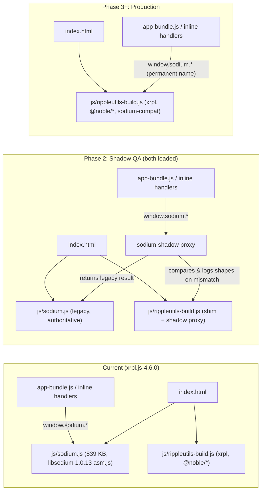

# Plan: Remove the libsodium dependency (`www/js/sodium.js`)

**Branch base:** `xrpl.js-4.6.0`  **Proposed working branch:** `remove-libsodium`
**Status:** Plan finalized (no app code changed yet). All open decisions confirmed on 2026-10-29 (see §11).

---

## 1. Goal and constraints

Remove the vendored `www/js/sodium.js` (libsodium-sumo **1.0.13**, asm.js build, ~840 KB, the largest file in `www/js/`). Replace it with small, audited, pure-JS primitives from the `@noble` family (already used by `xrpl`) plus native WebCrypto CSPRNG and a ~40-line verified SipHash-2-4 helper.

**Hard constraint: wallets already on users' devices must keep working.**
PouchDB already holds PIN hashes, passphrase and recovery-phrase hashes, and secretbox-encrypted account secrets, all produced by libsodium. Users also hold exported backup codes. Every byte format must stay identical. A single-bit difference in a KDF or MAC locks users out of their funds.

**Approach (reflecting confirmed decisions in §11):**
- **Permanent `window.sodium` compatibility shim:** implement **only the 19-symbol subset of the libsodium.js 1.0.13 API this app uses**, keeping the `window.sodium` global name permanently so zero `sodium.*` call sites in `ui/` or `views/` need renaming.
- **Golden vectors + side-by-side shadow mode:** prove byte-equality offline with differential tests and frozen golden vectors, then run old and new side by side in the live app during QA (`sodium-shadow.js`, logging any mismatch without leaking secrets) before deleting `sodium.js`.
- **Legacy PIN support + automatic upgrade:** keep SipHash-2-4 permanently so legacy 16-byte-salt PINs always verify, and transparently upgrade them to 32-byte-salt scrypt on the next successful unlock.
- **Host performance gate:** verify primitives and composite wallet flows on this host against measured `sodium.js` baselines.

---

## 2. Current usage inventory

### 2.1 Files that call `sodium.*`

| File | Calls | What for |
|---|---:|---|
| `www/js/ui/settings.js` | 82 | Set or change the passphrase and recovery phrase, re-encrypt all account secrets, passphrase cache, recovery-phrase word generator |
| `www/js/ui/accounts.js` | 44 | Encrypt a new account secret, decrypt a secret for signing or display, recovery-key handling |
| `www/js/modules/crypto.js` | 11 | `setPin`, `validatePin` (scrypt plus legacy SipHash), `tohex_chksum`, `fromhex_chksum`, `randShuffleArray` |
| `www/js/ui/backup.js` | 4 | BLAKE2b-4 checksum on backup export and import |
| `www/js/ui/payments.js` | 4 | Confirmation-screen integrity hash (BLAKE2b-16, keyed by nonce), offline-code checksum (BLAKE2b-1) |
| `www/js/ui/orders.js` | 4 | Confirmation integrity hash |
| `www/js/ui/trustlines.js` | 4 | Confirmation integrity hash, `randombytes_random()` nonce in inline HTML |
| `www/js/ui/flags.js` | 2 | Confirmation integrity hash |
| `www/js/app-logic.js` | 1 | Commented-out code only |
| `www/views/tab{payments,neworder,addtrustline,modifytrustline,accountflags}.html` | 5 | `sodium.randombytes_random()` in inline `ontouchend` handlers |
| `www/index.template.html` | 1 | `<script src="js/sodium.js">` |
| `www/index.html`, `www/js/app-bundle.js` | n/a | **Generated.** Rebuilt by `utils-build/update`. |

### 2.2 API surface actually used (19 symbols)

| libsodium.js symbol | Uses | Notes |
|---|---:|---|
| `crypto_pwhash_scryptsalsa208sha256(len, pw, salt, ops, mem [,fmt])` | 21 | Always called with `ops=4, mem=33554432` (all `*_LIMIT_INTERACTIVE` references are inside comments). `pw` is a string or a 16-byte `Uint8Array` (nested KDF). |
| `crypto_generichash(len, msg, key [,fmt])` | 19 | BLAKE2b. `len` ∈ {1, 4, 16}. `key` ∈ {`''`, `''+nonce` (short decimal string), `'offlinecode'`}. `fmt='hex'`. |
| `randombytes_buf(n [,fmt])` | 14 | `n` ∈ {1, 16, 24, 32}; optional `fmt` supported by `sodium.js` |
| `randombytes_random()` | 9 | Unsigned 32-bit integer in `[0, 2^32)`. Used as a nonce and in `% arr.length` (biased, see §6 Phase 7). |
| `crypto_secretbox_easy(msg, nonce, key [,fmt])` | 6 | XSalsa20-Poly1305. `msg` is a string seed or a 16-byte recovery key. Some calls pass `fmt='hex'`. |
| `crypto_secretbox_open_easy(ct, nonce, key [,fmt])` | 4 | Must **throw** on MAC failure or short ciphertext (`< 16` B), because callers rely on `try/catch` → `failurefunc()` |
| `to_hex` / `from_hex` | 7 / 7 | **Lowercase** hex output; `from_hex` throws `TypeError` on empty, odd-length, whitespace, or non-hex input |
| `to_string` / `from_string` | 2 / 1 | UTF-8. `to_string` throws on invalid UTF-8 sequences. |
| `crypto_shorthash(msg, key [,fmt])` | 3 | SipHash-2-4 (8-byte digest, 16-byte key). Used for the **legacy 16-byte-salt PIN** check and the in-memory passphrase cache. |
| Constants | many | `crypto_box_NONCEBYTES=24`, `crypto_secretbox_KEYBYTES=32`, `crypto_box_SECRETKEYBYTES=32`, `crypto_pwhash_scryptsalsa208sha256_SALTBYTES=32`, `crypto_shorthash_KEYBYTES=16`, plus comment-referenced `crypto_pwhash_OPSLIMIT_INTERACTIVE=4` and `crypto_pwhash_MEMLIMIT_INTERACTIVE=33554432` |

Nothing in first-party code uses `sodium.ready`, the `libsodium` global, or the Emscripten `Module` global outside `sodium.js` itself.

### 2.3 Facts already verified against the vendored `sodium.js`

The vendored `www/js/sodium.js` was loaded in Node v24.13.1 and probed directly (probe scripts live outside the repo in `/root/.gemini/antigravity-cli/brain/c2c9422b-f194-4dcd-be8a-358bd9faa444/scratch/`):

| Check | Result |
|---|---|
| libsodium version | `1.0.13` (synchronous API, no `ready` promise) |
| `crypto_pwhash_scryptsalsa208sha256(…, 4, 33554432)` equals standard scrypt with **N=1024, r=8, p=1** | ✅ byte-identical to Node `crypto.scryptSync`, for both string and `Uint8Array` passwords |
| `crypto_generichash(64, m, '')` equals standard BLAKE2b-512 | ✅ |
| `crypto_generichash` accepts `len` ∈ `[1, 64]`, `key` ∈ `0..64` bytes (`''`, `null`, `undefined` all unkeyed), and throws outside those bounds | ✅ |
| `crypto_secretbox_easy` output length & layout | `msg.length + 16` (16-byte Poly1305 MAC ‖ ciphertext, NaCl `secretbox_easy` layout) |
| `crypto_secretbox_open_easy` with wrong key / short ciphertext / wrong nonce or key length | throws |
| `from_hex('')`, `from_hex('abc')`, `from_hex('aa bb')`, `from_hex('zz')` | all throw `TypeError("The provided string doesn't look like hex data")` (`sodium.js:244` uses `/^[0-9a-f]+$/i`, requiring `>= 2` hex chars) |
| `to_hex` casing | **lowercase** (`[0-9a-f]`); `www/js/ui/backup.js:306` enforces `/^[a-f0-9]+$/m` (uppercase would break backup validation) |
| `to_string(invalid UTF-8)` | throws `"The encoded data was not valid for encoding utf-8"` |
| `siphash24` BigInt prototype vs `sodium.crypto_shorthash` | ✅ 64/64 official SipHash-2-4 paper vectors match byte-for-byte (`vec[15] = e545be4961ca29a1`) |
| Exact constants in `sodium.js` | `NONCEBYTES=24`, `KEYBYTES=32`, `SECRETKEYBYTES=32`, `SALTBYTES=32`, `shorthash_KEYBYTES=16`, `OPSLIMIT_INTERACTIVE=4`, `MEMLIMIT_INTERACTIVE=33554432` |

> [!NOTE]
> **Why N=1024:** In libsodium 1.0.13, `crypto_pwhash_OPSLIMIT_INTERACTIVE` (`4`) is Argon2's constant (scrypt's own constant is `524288`). When `4` and `33554432` are passed to `crypto_pwhash_scryptsalsa208sha256`, libsodium's `pickparams()` clamps `opslimit` up to `32768`. Because `32768 < 33554432 / 32`, it selects `r = 8`, `p = 1`, and `maxN = 32768 / (8 * 4) = 1024` (`N = 2^10 = 1024`). Real memory cost is `128 * r * N = 1 MiB` per KDF call.

---

## 3. Replacement libraries

| Need | Replacement | Dependency status |
|---|---|---|
| BLAKE2b (variable length 1–64 B, optional key 1–64 B) | `@noble/hashes/blake2b` → `blake2b(msg, { dkLen, key })` | `@noble/hashes@1.8.0` is already in `utils-build/package-lock.json` via `xrpl`. **Add as a direct dependency** pinned to `1.8.0` (`utils.js` already `require`s it transitively). |
| scrypt | `@noble/hashes/scrypt` → `scrypt(pw, salt, { N, r, p, dkLen })` | Same package (`@noble/hashes@1.8.0`) |
| XSalsa20-Poly1305 secretbox | `@noble/ciphers/salsa` → `xsalsa20poly1305(key, nonce)` (NaCl/libsodium `secretbox_easy` layout: 16-byte tag ‖ ciphertext) | **New dependency.** Pin **`@noble/ciphers@1.3.0`** (`--save-exact`). v2.x is ESM-only (`"type": "module"`) and incompatible with the CommonJS Browserify build; v1.3.0 exports CJS `./salsa`. |
| CSPRNG | `globalThis.crypto.getRandomValues` | Native in all modern browsers and Node 19+; works in non-HTTPS contexts (unlike `crypto.subtle`) |
| Hex / UTF-8 | Native `TextEncoder` / `TextDecoder('utf-8', { fatal: true })` + lowercase hex codec | Native |
| SipHash-2-4 | In-repo `utils-build/siphash24.js` (~40 lines, `BigInt`, §5.1) | Zero external dependency; not in `@noble` |

All `@noble` packages are audited and zero-dependency. Adding `@noble/ciphers/salsa`, `blake2b`, `scrypt`, and `siphash24` adds ~20 KB unminified to `rippleutils-build.js` while removing the 839 KB `sodium.js` asset.

---

## 4. Architecture



- `utils-build/rippleutils.js` attaches `window['sodium'] = require('./sodium-compat.js');` (with automatic shadow wrapping during Phase 2 if legacy `window.sodium` is already present).
- Script load order in `www/index.template.html` remains valid: `rippleutils-build.js` loads synchronously in `<head>` long before `app-bundle.js` at the end of `<body>`, and inline `ontouchend` handlers only fire after user interaction. None of the `<head>` scripts before `rippleutils-build.js` (`jquery`, `pouchdb`, `kjua`, `instascan`) touch `window.sodium`.

---

## 5. Specifications

### 5.1 Compatibility shim (`utils-build/sodium-compat.js`)

Each function must reproduce **libsodium.js 1.0.13 semantics** for every input shape used by the app.

> [!IMPORTANT]
> - **Permanent global name (decision §11.2):** `window.sodium` stays permanently. Keep the file header explicit that this is a `@noble`-backed compatibility subset, not full libsodium, and require golden vectors for any future additions.
> - **Lowercase hex trap:** Do **not** reuse `bytesToHex` from `utils-build/utils.js` — that helper emits uppercase hex, whereas `sodium.to_hex` emits lowercase hex and `www/js/ui/backup.js:306` rejects uppercase via `/^[a-f0-9]+$/m`.

```js
'use strict';
/*
 * sodium-compat.js — libsodium.js 1.0.13-compatible subset, exposed permanently as window.sodium.
 * NOT libsodium. Backed by @noble/hashes, @noble/ciphers, siphash24, and WebCrypto CSPRNG.
 * Every symbol here must remain byte- and error-compatible with libsodium 1.0.13;
 * see utils-build/test/fixtures/sodium-vectors.json. Do not add symbols without vectors.
 */
const { blake2b }          = require('@noble/hashes/blake2b');
const { scrypt }           = require('@noble/hashes/scrypt');
const { xsalsa20poly1305 } = require('@noble/ciphers/salsa');
const { siphash24 }        = require('./siphash24.js');

const enc = new TextEncoder();
const dec = new TextDecoder('utf-8', { fatal: true });

function toBytes(x, name) {
  if (typeof x === 'string') return enc.encode(x);
  if (x instanceof Uint8Array) return x;
  // Normalize cross-realm Uint8Array / Buffer (e.g. Node vm test contexts) for @noble instanceof checks
  if (ArrayBuffer.isView(x) && x.constructor &&
      (x.constructor.name === 'Uint8Array' || x.constructor.name === 'Buffer')) {
    return new Uint8Array(x.buffer, x.byteOffset, x.byteLength);
  }
  throw new TypeError((name || 'input') + ' must be a Uint8Array or string');
}

function checkFormat(fmt) {
  if (fmt !== undefined && fmt !== 'uint8array' && fmt !== 'hex' && fmt !== 'text') {
    throw new Error(fmt + ' output format is not available');
  }
}

function format(bytes, fmt) {
  checkFormat(fmt);
  if (fmt === undefined || fmt === 'uint8array') return bytes;
  if (fmt === 'hex') return to_hex(bytes);
  return to_string(bytes);
}

// --- encoding (matches sodium.js:220-245) ---
function to_hex(bytes) {
  const b = toBytes(bytes, 'bytes');
  let out = '';
  for (let i = 0; i < b.length; i++) out += b[i].toString(16).padStart(2, '0'); // lowercase!
  return out;
}

function from_hex(str) {
  // Note '+' (not '*'): sodium.from_hex('') throws TypeError in libsodium.js 1.0.13
  if (typeof str !== 'string' || str.length % 2 !== 0 || !/^[0-9a-f]+$/i.test(str)) {
    throw new TypeError("The provided string doesn't look like hex data");
  }
  const out = new Uint8Array(str.length / 2);
  for (let i = 0; i < str.length; i += 2) out[i >>> 1] = parseInt(str.slice(i, i + 2), 16);
  return out;
}

function from_string(str) {
  if (typeof str !== 'string') throw new TypeError('str must be a string');
  return enc.encode(str);
}

function to_string(bytes) {
  return dec.decode(toBytes(bytes, 'bytes')); // fatal: true throws TypeError on invalid UTF-8
}

// --- randomness ---
function randombytes_buf(length, fmt) {
  checkFormat(fmt);
  if (typeof length !== 'number' || !Number.isInteger(length) || length < 0) {
    throw new TypeError('length must be a non-negative integer');
  }
  const out = new Uint8Array(length);
  for (let off = 0; off < length; off += 65536) {
    crypto.getRandomValues(out.subarray(off, Math.min(off + 65536, length)));
  }
  return format(out, fmt);
}

function randombytes_random() {
  return crypto.getRandomValues(new Uint32Array(1))[0];
}

// --- BLAKE2b (crypto_generichash) ---
function crypto_generichash(hashLength, message, key, fmt) {
  checkFormat(fmt);
  if (typeof hashLength !== 'number' || !Number.isInteger(hashLength) || hashLength < 1 || hashLength > 64) {
    throw new Error('invalid hash_length');
  }
  const msgBytes = toBytes(message, 'message');
  const opts = { dkLen: hashLength };
  if (key !== undefined && key !== null) {
    const keyBytes = toBytes(key, 'key');
    if (keyBytes.length > 64) throw new Error('invalid key length');
    if (keyBytes.length > 0) opts.key = keyBytes; // '' / 0-byte key => unkeyed BLAKE2b
  }
  return format(blake2b(msgBytes, opts), fmt);
}

// --- scrypt (full port of libsodium escrypt pickparams) ---
function pickScryptParams(opslimit, memlimit) {
  if (typeof opslimit !== 'number' || typeof memlimit !== 'number' || opslimit < 0 || memlimit < 0) {
    throw new TypeError('invalid opslimit or memlimit');
  }
  const ops = opslimit < 32768 ? 32768 : opslimit;
  const r = 8;
  let N_log2 = 1;
  let p;
  if (ops < memlimit / 32) {
    p = 1;
    const maxN = ops / (r * 4);
    while (N_log2 < 63 && Math.pow(2, N_log2) <= maxN / 2) N_log2++;
  } else {
    const maxN = memlimit / (r * 128);
    while (N_log2 < 63 && Math.pow(2, N_log2) <= maxN / 2) N_log2++;
    let maxrp = (ops / 4) / Math.pow(2, N_log2);
    if (maxrp > 0x3fffffff) maxrp = 0x3fffffff;
    p = Math.floor(maxrp / r);
  }
  return { N: Math.pow(2, N_log2), r, p };
}

function crypto_pwhash_scryptsalsa208sha256(keyLength, password, salt, opsLimit, memLimit, fmt) {
  checkFormat(fmt);
  if (typeof keyLength !== 'number' || !Number.isInteger(keyLength) || keyLength < 16) {
    throw new Error('invalid keyLength');
  }
  const pwBytes = toBytes(password, 'password');
  const saltBytes = toBytes(salt, 'salt');
  if (saltBytes.length !== 32) throw new TypeError('invalid salt length');
  const { N, r, p } = pickScryptParams(opsLimit, memLimit);
  return format(scrypt(pwBytes, saltBytes, { N, r, p, dkLen: keyLength }), fmt);
}

// --- XSalsa20-Poly1305 secretbox ---
function crypto_secretbox_easy(message, nonce, key, fmt) {
  checkFormat(fmt);
  const m = toBytes(message, 'message');
  const n = toBytes(nonce, 'nonce');
  const k = toBytes(key, 'key');
  if (n.length !== 24) throw new TypeError('invalid nonce length');
  if (k.length !== 32) throw new TypeError('invalid key length');
  return format(xsalsa20poly1305(k, n).encrypt(m), fmt);
}

function crypto_secretbox_open_easy(ciphertext, nonce, key, fmt) {
  checkFormat(fmt);
  const c = toBytes(ciphertext, 'ciphertext');
  const n = toBytes(nonce, 'nonce');
  const k = toBytes(key, 'key');
  if (n.length !== 24) throw new TypeError('invalid nonce length');
  if (k.length !== 32) throw new TypeError('invalid key length');
  if (c.length < 16) throw new Error('ciphertext too short');
  return format(xsalsa20poly1305(k, n).decrypt(c), fmt); // throws Error('invalid tag') on bad MAC
}

// --- SipHash-2-4 (legacy PIN verification + session passphrase cache) ---
function crypto_shorthash(message, key, fmt) {
  checkFormat(fmt);
  const m = toBytes(message, 'message');
  const k = toBytes(key, 'key');
  if (k.length !== 16) throw new TypeError('invalid key length');
  return format(siphash24(m, k), fmt);
}

module.exports = {
  to_hex,
  from_hex,
  to_string,
  from_string,
  randombytes_buf,
  randombytes_random,
  crypto_generichash,
  crypto_pwhash_scryptsalsa208sha256,
  crypto_secretbox_easy,
  crypto_secretbox_open_easy,
  crypto_shorthash,
  crypto_box_NONCEBYTES: 24,
  crypto_secretbox_NONCEBYTES: 24,
  crypto_secretbox_KEYBYTES: 32,
  crypto_secretbox_MACBYTES: 16,
  crypto_box_SECRETKEYBYTES: 32,
  crypto_pwhash_scryptsalsa208sha256_SALTBYTES: 32,
  crypto_shorthash_KEYBYTES: 16,
  crypto_shorthash_BYTES: 8,
  crypto_pwhash_OPSLIMIT_INTERACTIVE: 4,
  crypto_pwhash_MEMLIMIT_INTERACTIVE: 33554432,
};
```

### 5.2 SipHash-2-4 helper (`utils-build/siphash24.js`)

Verified 64/64 against the official SipHash-2-4 paper vectors and `sodium.crypto_shorthash` (§2.3):

```js
'use strict';
const MASK64 = 0xffffffffffffffffn;
const rotl = (x, b) => ((x << b) | (x >> (64n - b))) & MASK64;

function readU64LE(buf, off) {
  let v = 0n;
  for (let i = 0; i < 8; i++) v |= BigInt(buf[off + i]) << BigInt(i * 8);
  return v;
}

function siphash24(msg, key) {
  if (!(key instanceof Uint8Array) || key.length !== 16) throw new TypeError('invalid key length');
  const k0 = readU64LE(key, 0);
  const k1 = readU64LE(key, 8);
  let v0 = 0x736f6d6570736575n ^ k0;
  let v1 = 0x646f72616e646f6dn ^ k1;
  let v2 = 0x6c7967656e657261n ^ k0;
  let v3 = 0x7465646279746573n ^ k1;

  function sipRound() {
    v0 = (v0 + v1) & MASK64; v1 = rotl(v1, 13n) ^ v0; v0 = rotl(v0, 32n);
    v2 = (v2 + v3) & MASK64; v3 = rotl(v3, 16n) ^ v2;
    v0 = (v0 + v3) & MASK64; v3 = rotl(v3, 21n) ^ v0;
    v2 = (v2 + v1) & MASK64; v1 = rotl(v1, 17n) ^ v2; v2 = rotl(v2, 32n);
  }

  const len = msg.length;
  const end = len - (len % 8);
  for (let off = 0; off < end; off += 8) {
    const m = readU64LE(msg, off);
    v3 ^= m; sipRound(); sipRound(); v0 ^= m;
  }
  let b = BigInt(len & 0xff) << 56n;
  for (let i = 0; i < len % 8; i++) b |= BigInt(msg[end + i]) << BigInt(i * 8);
  v3 ^= b; sipRound(); sipRound(); v0 ^= b;
  v2 ^= 0xffn;
  sipRound(); sipRound(); sipRound(); sipRound();

  let res = v0 ^ v1 ^ v2 ^ v3;
  const out = new Uint8Array(8);
  for (let i = 0; i < 8; i++) { out[i] = Number(res & 0xffn); res >>= 8n; }
  return out;
}

module.exports = { siphash24 };
```

### 5.3 Shadow wrapper specification (`utils-build/sodium-shadow.js`, QA builds only)

Decision §11.3: run the old and new implementations side by side during QA and log any mismatch.

**Activation** (in `utils-build/rippleutils.js` during Phase 2):
```js
const compat = require('./sodium-compat.js');
const legacy = window.sodium;                       // set by js/sodium.js when its <script> tag is present
if (legacy && typeof legacy.sodium_version_string === 'function') {
  window.sodium = require('./sodium-shadow.js')(legacy, compat);   // shadow mode (Phase 2 QA)
} else {
  window.sodium = compat;                                          // standalone shim
}
```
Shadow mode activates automatically whenever `js/sodium.js` loads before `js/rippleutils-build.js`. Phase 3 removes `js/sodium.js` and reduces `rippleutils.js` to `window['sodium'] = require('./sodium-compat.js');`.

**Behaviour (`Proxy` over `compat`):**

| Property kind | Shadow behaviour | Value returned to the app |
|---|---|---|
| Deterministic function (`crypto_generichash`, `crypto_pwhash_scryptsalsa208sha256`, `crypto_secretbox_easy`, `crypto_secretbox_open_easy`, `crypto_shorthash`, `to_hex`, `from_hex`, `to_string`, `from_string`) | Clone any `Uint8Array` arguments so neither side can mutate shared buffers. Run **legacy** (capturing return value or thrown error) and **compat** (capturing return value or thrown error). Compare outcome kind (both returned vs both threw vs split), then compare values (`Uint8Array` bytes compared in full; primitives with `Object.is`). | **Legacy result** (or rethrow legacy's exception). Legacy stays authoritative throughout Phase 2. |
| Random function (`randombytes_buf`, `randombytes_random`) | Outputs cannot match across two RNGs. Call **compat** so the WebCrypto CSPRNG is exercised live, validate output shape (`Uint8Array(n)` or uint32 integer in `[0, 2^32)`), and return it. Downstream hashes/ciphertexts using those random nonces/salts still run through deterministic comparison. | Compat result |
| Constant (`crypto_box_NONCEBYTES`, …) | Compared once when the shadow wrapper initializes; any constant mismatch is recorded immediately. | Legacy value |
| Symbol present **only on legacy** | Logged once to `unshimmed` (`console.warn('[sodium-shadow] UNSHIMMED', prop)`). Catches any API symbol missed by §2.2. | Legacy value (bound if function) |

**Logging rules (security-critical):**
- Inputs include PINs, passphrases, recovery phrases, and XRPL seeds; outputs include derived keys and plaintext seeds.
- **Never log raw arguments, return values, or hashes of them** (a 4-to-6 digit PIN hash is trivially reversible).
- Mismatch records contain **metadata and shapes only**: `{ fn, callIndex, argShapes: ['string(6)', 'Uint8Array(32)', 'number', 'number'], legacyOutcome: 'return:Uint8Array(32)', compatOutcome: 'throw:TypeError' }`.
- Expose `window.__sodiumShadow = { calls, mismatches, unshimmed, report() }` for QA inspection in DevTools. Shadow builds are never shipped to end users.

---

## 6. Phased implementation

### Phase 0: Safety net (golden vectors & real-wallet fixture)
1. Create branch `remove-libsodium` from `xrpl.js-4.6.0`.
2. Add `utils-build/test/load-legacy-sodium.js`:
   - Loads `www/js/sodium.js` (or, once deleted in Phase 3, optionally reads `git show xrpl.js-4.6.0:www/js/sodium.js` when available) via `vm.runInThisContext` wrapped in `(function(exports, module, define, require){ ... })()` so the UMD wrapper takes the browser-global path **and V8 links asm.js cleanly** (`vm.createContext` fails asm.js linking and runs slower).
3. Add `utils-build/test/gen-sodium-vectors.js` → writes `utils-build/test/fixtures/sodium-vectors.json`:
   - **scrypt:** `dkLen` ∈ {16, 32}, string passwords (ASCII, UTF-8 multibyte, empty, 200-char) and 16-byte `Uint8Array` passwords, plus **nested** `scrypt(32, scrypt(16, phrase, salt1), salt2)` matching `settings.js` and `accounts.js`, and invalid salt lengths (`throws: true`).
   - **generichash:** `len` ∈ {1, 4, 16, 32, 64} × `key` ∈ {`undefined`, `null`, `''`, `'0'`, `'4294967295'`, `'offlinecode'`, random 1–64 B} × messages (empty, ASCII, serialized confirmation JSON objects, binary), plus out-of-range `len` (0, 65) and `key` (65 B) marked `throws: true`.
   - **secretbox:** string and `Uint8Array` messages (empty, 1 B, 29-char secp256k1 & ed25519 XRPL seeds, 16-byte recovery key, 1 KB) with random keys/nonces in both `uint8array` and `'hex'` formats; `open_easy` positive cases plus negative cases (flipped tag bit, flipped ciphertext bit, wrong key, wrong nonce, 0-byte and 15-byte ciphertexts) marked `throws: true`.
   - **shorthash:** PIN strings (`'0000'`, `'123456'`, `'999999'`), passphrases, random 16-byte keys, `'hex'` and `uint8array` outputs, plus wrong key lengths (15 B, 32 B) marked `throws: true`.
   - **Encoding:** `to_hex`, `from_hex` (lowercase, uppercase, mixed, `''`, odd length, whitespace, non-hex — last four `throws: true`), `to_string` (ASCII, emoji/CJK UTF-8, invalid UTF-8 `0xff` `throws: true`), `from_string`.
   - **App composites & constants:** `tohex_chksum` / `fromhex_chksum` round-trips and corruption rejection, plus all exported constant values.
4. Build `utils-build/test/fixtures/wallet-v3.0.1.json`:
   - Contains complete PouchDB document payloads (`pindata` with 32-byte scrypt salt, `pindata_legacy` with 16-byte SipHash salt, `ppdata`, `rpdata`, `accounts` with encrypted secp256k1 and ed25519 seeds) and an exported **backup code string**, generated via legacy `sodium.js` using known test-only credentials (PIN `123456`, passphrase `correct horse battery`, known recovery phrase, test seeds).
   - ⚠️ Test credentials only — never real keys.
5. Commit generator and JSON fixtures as the immutable compatibility contract.

**Exit criteria:** `sodium-vectors.json` and `wallet-v3.0.1.json` are committed and reproducible.

### Phase 1: Shim, automated test suite, and benchmark harness
1. In `utils-build/`: `npm install --save-exact @noble/hashes@1.8.0 @noble/ciphers@1.3.0`. Verify `package-lock.json` deduplicates `@noble/hashes@1.8.0` with `xrpl`.
2. Implement `utils-build/siphash24.js` (§5.2) and `utils-build/sodium-compat.js` (§5.1).
3. Add zero-dependency tests using Node 24's built-in `node:test` and `node:assert/strict`:
   - `test/siphash.test.js`: all 64 official SipHash-2-4 paper test vectors.
   - `test/sodium-compat.test.js`: replays every vector in `sodium-vectors.json` (both return values and `throws: true` cases) and checks all constants.
   - `test/wallet-fixture.test.js`:
     - Evaluates the **real** `www/js/modules/crypto.js` in a `vm` context wired to `sodium-compat` and an in-memory mock `db` (`get` / `upsert`), verifying `validatePin` (32-byte scrypt `pindata`, 16-byte legacy `pindata_legacy`, wrong PIN rejection), `setPin`, `tohex_chksum`, and `fromhex_chksum`.
     - Executes the exact decryption/verification flows from `settings.js`, `accounts.js`, `db.js`, and `backup.js` against `wallet-v3.0.1.json`: `validatePassphrase`, `validateDataStores` checks, decrypting every account seed via both passphrase and recovery-phrase (`erk`) paths, and validating/importing the backup code.
   - `test/differential.test.js`: 1,000 randomized inputs per primitive comparing `load-legacy-sodium` vs `sodium-compat` (auto-skips if legacy `sodium.js` is unavailable).
   - `test/shadow.test.js`: tests `sodium-shadow.js` with injected faulty shims to verify mismatch detection, throw/return split detection, `UNSHIMMED` reporting, legacy authority, and **zero secret leakage** (asserts known test PINs, passphrases, seeds, and output hex never appear anywhere in captured logs or `__sodiumShadow`).
4. Add `utils-build/test/bench.js` (Phase 5) and add `"test": "node --test test/*.test.js"` and `"bench": "node test/bench.js"` to `utils-build/package.json`.

**Exit criteria:** `npm test` passes 100% with 0 differential mismatches.

### Phase 2: Side-by-side shadow run and manual QA
1. Add `utils-build/sodium-shadow.js` (§5.3) and wire the conditional shadow activation in `utils-build/rippleutils.js`. Keep `<script src="js/sodium.js"></script>` in `www/index.template.html`.
2. Run `cd utils-build && bash update` to rebuild `www/index.html`, `www/js/rippleutils-build.js`, and `www/js/app-bundle.js`.
3. Serve `www/` locally and verify in DevTools that `window.__sodiumShadow` is active.
4. Execute the manual QA matrix — first against a profile populated with legacy-created wallet data, then on a fresh wallet:

| # | Scenario | Exercises |
|---|---|---|
| 1 | Unlock with PIN; wrong PIN rejected | scrypt PIN, `fromhex_chksum` |
| 2 | Unlock with legacy 16-byte-salt PIN (injected `pindata_legacy`) | `crypto_shorthash` (SipHash-2-4) |
| 3 | Reset PIN via recovery phrase (`doResetPin`) | `validatePassphrase` (recovery), `setPin` |
| 4 | Reveal account secret with passphrase; wrong passphrase rejected | nested scrypt, `crypto_secretbox_open_easy`, `to_string` |
| 5 | Repeated actions hitting `_validatePassphraseCacheHit`, plus wrong passphrase | `crypto_shorthash` session cache |
| 6 | Prepare payment → confirm screen; tamper `confirmpay` in DevTools → rejected | keyed BLAKE2b-16, `randombytes_random` nonce |
| 7 | Place/cancel order, add/modify trustline, set account flags | keyed BLAKE2b-16 confirmation hashes + inline view `randombytes_random()` |
| 8 | Generate offline payment code & validate it (valid + corrupted checksum) | BLAKE2b-1 keyed `'offlinecode'` |
| 9 | Generate new account + import existing secp256k1 & ed25519 seeds | `crypto_secretbox_easy`, `tohex_chksum` |
| 10 | Change passphrase; lock/unlock; reveal all account secrets | Full account re-encryption loop in `settings.js` |
| 11 | Set new recovery phrase; use recovery phrase to reset passphrase | `erk` decrypt/re-encrypt, `rpdata`, syllable generator |
| 12 | Export backup; validate & import both an **old** backup code and the new export | BLAKE2b-4 checksum, lowercase hex check in `backup.js` |
| 13 | Corrupt a byte in PouchDB doc → reload (`validateDataStores`) | `fromhex_chksum` corruption detection |

5. Run `window.__sodiumShadow.report()` after completing the matrix and record the output.

**Exit criteria:** All 13 scenarios succeed, `mismatches.length === 0`, `unshimmed.length === 0`, and `calls` shows non-zero invocations across every function in §2.2.

### Phase 3: Switch over and delete `www/js/sodium.js`
1. Remove `<script src="js/sodium.js"></script>` from `www/index.template.html`.
2. `git rm www/js/sodium.js`.
3. Move `utils-build/sodium-shadow.js` to `utils-build/test/sodium-shadow.js` (so `test/shadow.test.js` remains active and shadow mode can be reused for any future crypto maintenance) and simplify `utils-build/rippleutils.js` to:
   ```js
   window['sodium'] = require('./sodium-compat.js');
   ```
4. Run `cd utils-build && bash update` to regenerate `www/index.html`, `www/js/rippleutils-build.js`, and `www/js/app-bundle.js`.
5. Hygiene checks:
   - `grep -rn "sodium\.js\|libsodium\|sodium-shadow" www/ utils-build/` matches only docs and `utils-build/test/`.
   - `grep -rn "\bModule\b" www/js/modules www/js/ui www/js/app-logic.js` confirms nothing referenced Emscripten's `Module`.
6. Run `npm test` in `utils-build/`.
7. Smoke-test QA scenarios 1, 2, 4, 6, 10, and 12 on the shim-only build, plus ** Scenario 14 (Downgrade check)**: open the IndexedDB wallet written by the shim-only build under `xrpl.js-4.6.0` HEAD (`sodium.js` build) and verify unlock, secret reveal, and backup export all succeed.

**Exit criteria:** `www/js/sodium.js` is gone (~840 KB saved), tests pass, and bidirectional compatibility with `xrpl.js-4.6.0` is proven.

### Phase 4: Legacy PIN auto-upgrade on next unlock (separate commit)
Decision §11.1: **keep** SipHash PIN support permanently, and **automatically upgrade** a legacy 16-byte-salt PIN to 32-byte-salt scrypt on the next successful unlock.

Keeping this in its own commit cleanly separates the intentional behaviour change from the pure-refactor removal in Phase 3.

**Change in `www/js/modules/crypto.js` (`validatePin`):**
```js
if (salt.length === 16) {
    // Legacy 16-byte-salt SipHash PIN. Verify first, then transparently re-store as 32-byte-salt scrypt.
    hash = tohex_chksum(sodium.crypto_shorthash(pin, salt));
    if (hash == pindata.hash) {
        // Guard against normalboot()'s validatePin("", ...) startup probe.
        if (pin !== "") {
            try {
                return setPin(pin,
                    function() {
                        if (debug) console.log("validatePin: upgraded legacy PIN to scrypt");
                        successfunc();
                    },
                    function() {
                        console.warn("validatePin: legacy PIN upgrade write failed; will retry next unlock");
                        successfunc();
                    });
            } catch (upgradeErr) {
                console.warn("validatePin: legacy PIN upgrade threw; will retry next unlock");
                return successfunc();
            }
        }
        return successfunc();
    }
    return failfunc();
}
```
Rebuild `www/js/app-bundle.js` via `cd utils-build && bash update` after editing `www/js/modules/crypto.js`.

**Why settle `setPin` before firing `successfunc()`:**
- `setPin` takes ~15 ms (one scrypt + one local PouchDB upsert) **once ever** on the single unlock that migrates a legacy PIN.
- Waiting for the upsert callback eliminates any race if the user immediately exports a backup or reloads, and makes automated tests completely deterministic without timers.
- Both the `failfunc` callback of `setPin` and the `catch` fallback still invoke `successfunc()`, so a transient IndexedDB write failure **never** locks the user out; the upgrade simply retries on the next unlock.
- **Schema compatibility verified:** both `validateDataStores` (`www/js/modules/db.js:107-109`) and backup validator `cleanBackupCode` (`www/js/ui/backup.js:331-337`) validate `pindata` solely via `fromhex_chksum` without restricting `pindata.salt` length, so upgraded documents pass startup checks and backup export/import unchanged.
- **SipHash remains in `sodium-compat.js` permanently** for unmigrated wallets, imported old backup codes (which carry legacy `pindata` until their next unlock!), and `_validatePassphraseCacheHit` (`www/js/ui/settings.js:333-348`).

**Additional unit tests in `test/wallet-fixture.test.js`:**
1. Legacy `pindata` + correct PIN → calls `successfunc`, replaces `pindata` in `db` with a 32-byte salt (`salt.length === 72` hex chars with 4-byte checksum), and a second `validatePin` call succeeds via scrypt while rejecting wrong PINs.
2. Legacy `pindata` + wrong PIN → calls `failfunc`, leaves `pindata` untouched (16-byte salt).
3. Legacy `pindata` + `""` boot probe → calls `failfunc`, leaves `pindata` untouched.
4. Simulated `db.upsert` rejection during upgrade → still calls `successfunc` and leaves legacy `pindata` intact for retry.

> [!WARNING]
> **Pre-scrypt downgrade note:** Once a legacy `pindata` upgrades to scrypt, builds from `a79238c8` (`xrpl.js-4.6.0`) onward verify it, whereas ancient pre-`a79238c8` builds (which knew only SipHash) would require a PIN reset via recovery phrase. Encrypted account secrets are unaffected because they are keyed by the passphrase/recovery phrase, not the PIN.

### Phase 5: Performance verification on this host
Decision §11.4: benchmark on this host (Linux, Node v24.13.1 / V8).

Old `sodium.js` baselines **already measured on this host** (asm.js linked via `vm.runInThisContext`, median across warm iterations):

| Operation | Measured old `sodium.js` baseline | Acceptance target (`sodium-compat`) |
|---|---:|---:|
| `scrypt` (1 call, N=1024, r=8, p=1, 32 B) | **12.1 ms** median (~14.4 ms cold mean; Node native `scryptSync` is 4.4 ms) | **≤ 25 ms** (≤ ~2×) |
| `BLAKE2b-16` keyed (confirmation JSON) | **0.077 ms** | **≤ 0.20 ms** |
| `secretbox` easy + open (31-byte seed) | **0.043 ms** | **≤ 0.15 ms** |
| `SipHash-2-4` (6-char PIN) | **0.007 ms** | **≤ 0.05 ms** |
| **Unlock** (1 scrypt) | **12.1 ms** | **≤ 25 ms** |
| **Reveal secret** (2 nested scrypt + open) | **21.7 ms** | **≤ 45 ms** |
| **Change passphrase — 1 account** (8 scrypt + box ops) | **94.4 ms** | **≤ 200 ms** |
| **Change passphrase — 10 accounts** (44 scrypt + box ops) | **573.5 ms** | **≤ 1,200 ms** (≤ ~2×) |

- `utils-build/test/bench.js` runs in Phase 1 (side-by-side against `www/js/sodium.js` on disk) and again after Phase 3 (`load-legacy-sodium.js` either loads `xrpl.js-4.6.0:www/js/sodium.js` via `git show` or compares against the recorded baseline table).
- Record exact numbers in `utils-build/test/BENCHMARK.md`.
- Fallback if pure-JS `@noble/hashes/scrypt` exceeds 2×: inspect V8 deopt/typed-array allocation first; if still >2×, evaluate `@noble/hashes` `scryptAsync` for the multi-account re-encryption loop before proceeding to Phase 3.

### Phase 6: Documentation updates
- `README.md`: document removal of `www/js/sodium.js`, the permanent `window.sodium` compatibility layer in `utils-build/sodium-compat.js`, `@noble/hashes` + `@noble/ciphers`, and `npm test` / `npm run bench` in `utils-build/`.
- `www/api.md`: update the architecture diagram and §1 Cryptographic API section (replace `sodium.js` / SipHash-only PIN notes with `sodium-compat.js`, scrypt PIN storage, and automatic legacy SipHash PIN migration).
- `www/risk.md`: update the PIN hashing finding to reflect 32-byte-salt scrypt + automatic legacy PIN upgrade on unlock.
- `www/update_plan.md`: update the Libsodium row from `libsodium-wrappers` to `@noble/hashes` + `@noble/ciphers` via `sodium-compat.js`.
- `utils-build/test/README.md`: document how to run tests, benchmarks, vector regeneration (`git show xrpl.js-4.6.0:www/js/sodium.js`), and how to re-enable `test/sodium-shadow.js` if ever needed.

### Phase 7 (optional, separate PRs): Follow-up hardening
Kept strictly out of the libsodium-removal PRs:
1. **Eliminate modulo bias** (`www/risk.md`): add `randombytes_uniform(upper_bound)` (rejection sampling, matching libsodium's signature) to `sodium-compat.js` and use it in `settings.js:138` (recovery-phrase word generator) and `crypto.js:59` (`randShuffleArray`). Affects newly generated values only; zero storage-format impact.
2. **Session passphrase cache**: optionally switch `_validatePassphraseCacheHit` from 64-bit SipHash to 256-bit keyed BLAKE2b with a 32-byte per-session random key (in-memory only).
3. **Stronger KDF parameters**: raising scrypt above `N=1024` requires a versioned envelope (e.g., `{ v: 2, N: 32768, ... }`) with migrate-on-unlock, designed separately.

---

## 7. File change checklist

| File | Change | Phase |
|---|---|---:|
| `utils-build/test/load-legacy-sodium.js` | **New**: `vm.runInThisContext` loader (with `git show` fallback post-Phase 3) | 0 |
| `utils-build/test/gen-sodium-vectors.js` | **New**: golden vector & wallet fixture generator | 0 |
| `utils-build/test/fixtures/sodium-vectors.json` | **New**: frozen primitive & composite test vectors | 0 |
| `utils-build/test/fixtures/wallet-v3.0.1.json` | **New**: legacy-generated wallet & backup fixture (incl. legacy 16-B salt PIN) | 0 |
| `utils-build/package.json` | Pin `@noble/hashes@1.8.0`, `@noble/ciphers@1.3.0`; add `test` and `bench` scripts | 1 |
| `utils-build/package-lock.json` | Regenerated lockfile | 1 |
| `utils-build/siphash24.js` | **New**: SipHash-2-4 implementation | 1 |
| `utils-build/sodium-compat.js` | **New**: permanent `window.sodium` compatibility shim | 1 |
| `utils-build/test/{siphash,sodium-compat,wallet-fixture,differential,shadow}.test.js` | **New**: `node:test` test suite | 1, 4 |
| `utils-build/test/bench.js`, `utils-build/test/BENCHMARK.md` | **New**: host benchmark script and recorded results | 1, 5 |
| `utils-build/sodium-shadow.js` → `utils-build/test/sodium-shadow.js` | **New** in Phase 2 for live QA; moved into `test/` in Phase 3 | 2–3 |
| `utils-build/rippleutils.js` | Shadow activation in Phase 2 → `window['sodium'] = require('./sodium-compat.js')` in Phase 3 | 2–3 |
| `www/index.template.html` | Remove `<script src="js/sodium.js"></script>` | 3 |
| `www/js/sodium.js` | **Deleted** (~840 KB removed) | 3 |
| `www/js/modules/crypto.js` | Auto-upgrade legacy 16-byte-salt PINs on successful `validatePin` | 4 |
| `www/index.html`, `www/js/rippleutils-build.js`, `www/js/app-bundle.js` | Regenerated via `utils-build/update` | 2–4 |
| `www/js/ui/*.js`, `www/views/*.html` | **No changes** (`window.sodium` name is kept permanently) | — |
| `README.md`, `www/api.md`, `www/risk.md`, `www/update_plan.md`, `utils-build/test/README.md` | Documentation updates | 6 |

Recommended commit sequence:
1. `test(crypto): capture libsodium 1.0.13 golden vectors and wallet fixture`
2. `feat(crypto): add @noble-backed sodium-compat shim, SipHash-2-4, tests, and benchmark`
3. `test(crypto): enable side-by-side sodium shadow verification for QA`
4. `refactor(crypto): remove vendored sodium.js and switch to sodium-compat`
5. `feat(crypto): auto-upgrade legacy SipHash PINs to scrypt on unlock`
6. `docs: update architecture and security docs for libsodium removal`

---

## 8. Risks and mitigations

| Risk | Impact | Mitigation |
|---|---|---|
| scrypt parameter mismatch | **Critical**: users locked out | Verified `N=1024, r=8, p=1` against `sodium.js` and `crypto.scryptSync` (§2.3); full `pickScryptParams` ported; nested-KDF golden vectors, wallet fixture test, live shadow run, and Phase 3 downgrade check |
| secretbox MAC/ciphertext layout mismatch | **Critical**: secrets fail to decrypt | `@noble/ciphers` `xsalsa20poly1305` uses NaCl `tag ‖ ct` layout; verified by cross-decrypt vectors, 1,000-run differential test, shadow run, and downgrade check |
| Uppercase vs lowercase hex (`to_hex`) or empty-string `from_hex('')` mismatch | **High**: backup validation rejects valid backups (`backup.js:306`) or corrupt check diverges | Caught during planning (§2.3): `to_hex` outputs lowercase `[0-9a-f]`; `from_hex` uses `/^[0-9a-f]+$/i` so `''` throws `TypeError` just like `sodium.js` |
| Cross-realm `Uint8Array` rejected by `@noble` in `vm` tests | Medium: false test failures | `toBytes()` normalizes cross-realm `Uint8Array`/`Buffer` views into host `Uint8Array` (§5.1) |
| BLAKE2b edge cases (1-byte / 4-byte outputs, short keys like `'0'`) | High: confirmations or backups fail | Covered across all `(len, key)` combinations in `sodium-vectors.json` and live shadow QA |
| Missed `sodium.*` API call in codebase | High: runtime `TypeError` | Shadow `Proxy` logs `UNSHIMMED` on any property access not in `sodium-compat.js`; Phase 2 requires full QA matrix with `unshimmed.length === 0` |
| Shadow mode logs leak user secrets | **High** | Logs record argument/result **shapes only**, never values or hashes; enforced by `test/shadow.test.js`; shadow build never shipped |
| Legacy PIN auto-upgrade race or failed DB write locks user out | **High** | `setPin` settles (~15 ms) before `successfunc()`, and both `setPin` failure and `catch` paths still invoke `successfunc()` so unlock never fails; `pin !== ""` skips `normalboot()` probe |
| Imported old backup re-introduces legacy 16-byte-salt `pindata` | Medium | `siphash24` stays in `sodium-compat.js` permanently; next unlock after backup import verifies and auto-upgrades it |
| `@noble/ciphers` v2 installed (ESM-only) | Build breaks | Exact version pin `@noble/ciphers@1.3.0` (`--save-exact`) |
| Pure-JS scrypt slower than asm.js | UX lag on 10+ account passphrase change | Benchmarked against measured host baselines (12.1 ms/scrypt, 573.5 ms/10-account re-key) with 2× budget and `scryptAsync` fallback |

---

## 9. Rollback

- **Phases 0–2** are purely additive; legacy `www/js/sodium.js` remains loaded and **authoritative** (shadow mode always returns legacy results).
- **Phase 3** is a single switch-over commit. `git revert` restores `www/js/sodium.js` cleanly. Because byte formats are 100% identical, wallets created or modified under `sodium-compat.js` open directly in `sodium.js` with **zero data migration**.
- **Phase 4** is an isolated commit on `www/js/modules/crypto.js` and can be reverted independently; any PIN already upgraded to 32-byte-salt scrypt remains valid on `xrpl.js-4.6.0` HEAD.

---

## 10. Effort estimate

| Phase | Estimate |
|---|---|
| Phase 0: Legacy loader, golden vectors & wallet fixture | 0.5 day |
| Phase 1: `sodium-compat`, `siphash24`, unit/differential/shadow tests & `bench.js` | 1 day |
| Phase 2: Shadow activation & 13-scenario manual QA | 0.5–1 day |
| Phase 3: Delete `sodium.js`, rebuild bundles & downgrade check | 0.5 day |
| Phase 4: Legacy PIN auto-upgrade + unit tests | 0.25 day |
| Phase 5: Host benchmark run & `BENCHMARK.md` | 1–2 hours |
| Phase 6: Docs (`README.md`, `www/api.md`, `www/risk.md`, `www/update_plan.md`) | 1–2 hours |
| **Total (Phases 0–6)** | **~3–3.5 days** |
| Phase 7: Optional follow-up hardening | 0.5–2 days |

---

## 11. Decisions (confirmed 2026-10-29)

| # | Question | Confirmed decision | Plan sections |
|---|---|---|---|
| 1 | Legacy SipHash PIN support | **Keep supporting legacy 16-byte-salt PINs permanently, and automatically upgrade them to 32-byte-salt scrypt on the next successful unlock** | §1, §5.2 (`siphash24.js`), §6 Phase 4 |
| 2 | Global name | **Keep `window.sodium` permanently** (no call-site renames in `ui/` or `views/`) | §1, §4, §5.1, §7 |
| 3 | Shadow mode | **Run old and new side by side during QA and log any mismatch** (shapes only, never secret values) | §4, §5.3, §6 Phase 2 |
| 4 | Performance check | **Checking performance on this host is sufficient** | §6 Phase 5 (all 8 host baselines measured) |
