# Plan: Replace UI, DOM & PouchDB Dependencies with Vanilla JS, CSS & IndexedDB

**Current branch:** `remove-libsodium`  **Proposed working branch:** `vanilla-ui` (or continue on `remove-libsodium`)
**Status:** Plan finalized (no app code changed yet). Updated on 2026-10-29 to include PouchDB & `pouchdb-upsert` replacement alongside all 6 UI/DOM libraries (see §9).

---

## 1. Goal, scope & target dependency footprint

Replace **every** remaining third-party UI, DOM, CSS, and local-storage library in `www/` with small, auditable, first-party vanilla JavaScript, vanilla CSS, and native IndexedDB:

1. **Clipboard** (`www/js/clipboard.js` + hardening `www/js/modules/clipboard.js` — **32 KB**)
2. **PouchDB & `pouchdb-upsert`** (`www/js/pouchdb.min.js`, `www/js/pouchdb.upsert.min.js`, and `"pouchdb"` / `"pouchdb-upsert"` in `utils-build/package.json` — **142 KB** + transitive npm tree)
3. **Hashicon** (`www/js/hashicon.js` — **28 KB**)
4. **FontAwesome 5** (`www/fontawesome/` — **19 MB**)
5. **Bootstrap 3** (`www/css/bootstrap*.css*`, `www/js/bootstrap.min.js` — **1.35 MB**)
6. **Select2** (`www/js/select2.js`, `www/css/select2.css` — **172 KB**)
7. **jQuery** (`www/js/jquery-3.7.1.min.js`, `www/js/jquery.mobile-1.4.5.min.js`, `"jquery"` in `utils-build/package.json` — **284 KB**)

**Hard constraints:**
- **Zero wallet data loss on upgrade (hard storage constraint):** Existing wallets already stored on users' devices inside PouchDB's IndexedDB database (`_pouch_toastwallet` v5 `document-store` + `by-sequence`) must be **automatically and non-destructively migrated** on first boot into the vanilla IndexedDB store (`toastwallet_kv`), leaving `_pouch_toastwallet` intact on disk so downgrade/rollback never loses keys.
- **Zero visual or behavioral regression:** All 39 views (`www/views/*.html`), touch/mouse interactions, 3-state XRPL account flag toggles, form layouts, spinners, modals, and XRP account identicons must continue working identically across desktop browsers, mobile WebViews (Cordova/Capacitor), and Electron.
- **Incremental, shippable phases:** Order the replacements so each library is removed in an isolated, buildable commit (with Select2 decoupled *before* jQuery is removed), keeping the wallet runnable and testable at every step.

**Confirmed design approach (see §9):**
- **Native IndexedDB `WalletDB` with lossless `_pouch_toastwallet` migration:** Implement `www/js/modules/storage.js` (~140 lines) providing the exact `get(docId)` / `upsert(docId, diffFn)` Promise API used across all 69 `db.*` call sites, backed by native IndexedDB (`toastwallet_kv`) with per-key serialized atomic upserts, `tx.oncomplete` durability, `localStorage` fallback, and automatic read-only migration from PouchDB's `_pouch_toastwallet`.
- **100% pixel-identical `hashicon`:** Port the 4×7 triangle canvas renderer onto `@noble/hashes/sha3` (`keccak_256`) in `utils-build/hashicon.js` so existing users' XRP account identicons remain unchanged.
- **Uniform `custom-select` across all 6 `<select>` elements:** Enhance `#payfromaccount` (20×20 `hashicon` avatar + label), `#valuationcurrency` (searchable), `#ntloexpiry` (searchable + custom expiry toggle), `#payasset` (with offline `destroySelect` & visibility sync), `#atlrippling`, and `#ntloexpirycustomunit`.
- **Complete removal of `window.$`, `window.jQuery`, and `window.PouchDB`:** No fake `$` global alias; migrate all 727 `$` call sites to native DOM APIs + explicit helpers in `www/js/modules/dom.js` (`byId`, `qs`, `qsa`, `showEl`, `hideEl`, `domData`, etc.).

### 1.1 Before vs. after external runtime dependencies

| Layer | Before this plan | After this plan | Assets removed |
|---|---|---|---|
| **Ledger, Crypto & QR** (`rippleutils-build.js`) | `xrpl@4.6.0`, `@noble/hashes@1.8.0`, `@noble/ciphers@1.3.0`, `qr@^0.7.2` | Unchanged (+ ~80-line first-party `hashicon.js` using `@noble/hashes/sha3`) | — |
| **Local Storage** | `www/js/pouchdb.min.js` + `pouchdb.upsert.min.js` + npm `pouchdb*` | First-party `www/js/modules/storage.js` (native `IndexedDB` + `_pouch_toastwallet` migrator) | **142 KB** + npm `pouchdb*` |
| **Clipboard** | `www/js/clipboard.js` (dead) + `modules/clipboard.js` | First-party `www/js/modules/clipboard.js` (Web Clipboard API + `execCommand` fallback) | **32 KB** |
| **Identicons** | `www/js/hashicon.js` (bundles `js-sha3`) | First-party `utils-build/hashicon.js` (2D `<canvas>` + `@noble/hashes/sha3`) | **28 KB** |
| **Icons** | `www/fontawesome/` (full FA 5 Free release) | First-party `www/css/icons.css` (~7 KB embedded SVG `mask-image` sheet, 28 glyphs) | **~19.0 MB** |
| **Base / Controls CSS** | `www/css/bootstrap*.css*` + `www/js/bootstrap.min.js` | First-party `www/css/base.css` (~180 lines: reboot + 13 used classes) | **~1.35 MB** |
| **Rich `<select>` UI** | `www/js/select2.js` + `www/css/select2.css` | First-party `www/js/modules/custom-select.js` + `www/css/custom-select.css` | **172 KB** |
| **DOM & Events** | `www/js/jquery-3.7.1.min.js` + `jquery.mobile-1.4.5.min.js` | Native DOM APIs + ~120-line first-party `www/js/modules/dom.js` | **284 KB** + npm `"jquery"` |
| **Total vendor files in `www/`** | **~21.01 MB** across ~2,800+ vendored files | **0 external vendor files in `www/`** (~24 KB first-party JS/CSS total) | **~21.0 MB removed (100%)** |

After this migration, **100% of external vendor JS/CSS files in `www/` are eliminated**, and `utils-build/package.json` `dependencies` drops to **only 4 runtime packages**:
1. `xrpl` (`4.6.0`, incl. `bignumber.js`)
2. `@noble/hashes` (`1.8.0`)
3. `@noble/ciphers` (`1.3.0`)
4. `qr` (`^0.7.2`, `@paulmillr/qr`)

---

## 2. Complete codebase audit & hidden couplings

### 2.1 Dead / unloaded vendor assets & unused npm dependencies (immediate zero-risk purge)

Inspection of `www/index.template.html` and `utils-build/` confirms these vendored files and npm entries are **never loaded or `require()`d** anywhere at runtime:

| Unused asset / package | Size | Status |
|---|---:|---|
| `www/js/jquery.mobile-1.4.5.min.js` | 196 KB | Not referenced in `index.template.html` or any JS file |
| `www/js/bootstrap.min.js` | 40 KB | Not referenced in `index.template.html`; zero Bootstrap JS plugins used |
| `www/js/clipboard.js` | 32 KB | Not referenced in `index.template.html`; superseded by `www/js/modules/clipboard.js` |
| `www/css/bootstrap.css` | 144 KB | Unminified duplicate (`index.template.html:8` loads `bootstrap.min.css`) |
| `www/css/bootstrap.css.map`, `bootstrap.min.css.map` | 916 KB | Unused source maps |
| `www/css/bootstrap-theme.css`, `.min.css`, `*.map` | 128 KB | Not linked anywhere |
| `"jquery"`, `"node-pre-gyp"`, `"random-bytes"` in `utils-build/package.json` | npm deps | Never `require()`d anywhere in `utils-build/*.js` or `www/js/*.js` |

---

### 2.2 Clipboard (`www/js/clipboard.js` & `www/js/modules/clipboard.js`)

- `www/js/modules/clipboard.js` (18 lines) already implements `window.clipboardCopy(data)` (`navigator.clipboard.writeText`) and `window.clipboardPaste(f)` (`navigator.clipboard.readText`).
- **Call sites:** `clipboardCopy(...)` is called 7 times (`tabaccountdetails.html:27`, `tabaccountsecret.html:9`, `tabbackup2.html:9`, `tabdonate.html:10`, `tabgreenqr.html:11`, `tabshowrecovery.html:11`, `ui/transactions.js:90`). `clipboardPaste(...)` is called 9 times across payment, trustline, account import, restore, and offline-tx views.
- **Bugs & gaps uncovered during audit:**
  1. **Broken inline `onpaste` handler in `www/views/tabpayments.html:22`:**
     ```html
     onpaste="(e)=>{populatePaymentTabFromURI(e.originalEvent.clipboardData.getData('Text'));}"
     ```
     This has two defects: (a) an inline HTML `onpaste="(e)=>{...}"` evaluates an arrow-function expression **without invoking it** (silent no-op!), and (b) `e.originalEvent` is a jQuery wrapper property that is `undefined` on a native `ClipboardEvent`. Native code must invoke `populatePaymentTabFromURI((event.clipboardData || window.clipboardData).getData('text'))`.
  2. **Missing non-HTTPS / WebView fallback & rejection handling:** `navigator.clipboard` is `undefined` on insecure HTTP origins (e.g., local LAN testing) and throws `NotAllowedError` when clipboard permissions are denied. `clipboardCopy` currently throws synchronously if `navigator.clipboard` is missing and drops promise rejections unhandled.
  3. **Legacy markup attributes:** 7 copy buttons still carry unused `data-clipboard-target="#..."` attributes and class `copybtnaction` (leftover from `clipboard.js`). Note: `.copybtn` **is** styled in `www/css/app.css:1054` and must be preserved.

---

### 2.3 PouchDB & `pouchdb-upsert` (`www/js/pouchdb.min.js`, `www/js/pouchdb.upsert.min.js`)

- Loaded via `<script src="js/pouchdb.min.js"></script>` (136 KB) and `<script src="js/pouchdb.upsert.min.js"></script>` (5.5 KB) in `www/index.template.html:14-15`, plus mirrored in `utils-build/package.json` (`"pouchdb": "^9.0.0"`, `"pouchdb-upsert": "^2.2.0"`).
- **Minimal actual usage surface across the entire codebase (69 `db.*` calls + 1 constructor call):**
  - **Single instantiation (`www/js/app-logic.js:570`):** `db = new PouchDB('toastwallet');` (synchronous construction followed immediately on lines 591–624 by `loadSavedInterfaceSettings()`, `getSavedGateways(...)`, and `validateDataStores(...)`).
  - **Only 2 methods ever called on `db`:**
    1. `db.get(docId)` — **32 call sites** (`modules/db.js` ×8, `ui/backup.js` ×9, `ui/settings.js` ×7, `app-logic.js` ×6, `ui/accounts.js` ×3 — note `modules/crypto.js` ×1).
    2. `db.upsert(docId, diffFn)` — **37 call sites** (`ui/backup.js` ×18, `ui/settings.js` ×3, `ui/login.js` ×4, `ui/accounts.js` ×4, `modules/db.js` ×1, `modules/crypto.js` ×1, `modules/navigation.js` ×1, `modules/xrpl-client.js` ×1, `ui/payments.js` ×1, `app-logic.js` ×1).
  - **Zero CouchDB features used:** No `replicate`, `sync`, `changes`, `allDocs`, `bulkDocs`, `query`, `find`, `putAttachment`, revision conflict trees, or multi-rev reads anywhere in the repo.
  - **Complete inventory of all 8 document keys in `'toastwallet'`:**

| Key (`_id`) | Stored shape | Purpose |
|---|---|---|
| `"pindata"` | `{ data: JSON.stringify({ salt, hash }) \| "" }` | Encrypted/hashed wallet unlock PIN (scrypt or legacy SipHash) |
| `"ppdata"` | `{ data: JSON.stringify({ salt1, salt2, hash }) \| "" }` | Passphrase verification salts & hash |
| `"rpdata"` | `{ data: JSON.stringify({ salt1, salt2, hash, erk }) \| "" }` | Recovery phrase verification salts, hash & encrypted recovery key |
| `"accounts"` | `{ data: JSON.stringify({ [addr]: { ppsalt, rpsalt, ppsecret, rpsecret, nickname, ... } }) \| "" }` | All encrypted XRP account secrets & metadata |
| `"savedgateways"` | `{ data: JSON.stringify({ gateways: [...] }) }` | Custom XRPL WebSocket server URLs |
| `"interfacesettings"` | `{ data: JSON.stringify({ valuation_counterparty, valuation_currency, display_xaddresses }) }` | Fiat valuation & X-address display preferences |
| `"lastbackupreminder"` | `{ data: JSON.stringify({ lastreminder: "<epochSec>" }) }` | Timestamp of last backup prompt |
| `"lastdonated"` | `{ data: JSON.stringify({ lastdonated: "<epochSec>" }) }` | Timestamp of last donation prompt |

- **Critical behavioral contracts & on-disk migration schema verified directly from `www/js/pouchdb.min.js`:**
  1. **`db.get(docId)` missing-key rejection contract:**
     - `exportWallet` (`ui/backup.js:202-218`) and `importWallet` (`ui/backup.js:234-288`) rely on `db.get(key)` **rejecting** when a document does not exist yet so `.catch(...)` runs!
     - Meanwhile, `db.get(key).then(f).catch(f)` callers (`modules/db.js`, `modules/crypto.js`, `ui/accounts.js`, `ui/settings.js`) pass the same callback `f` to both `.then` and `.catch` and check `if (arg.data == undefined)`.
     - Rejecting missing keys with an `Error` carrying `{ status: 404, name: 'not_found', message: 'missing', error: true }` (where `err.data` is `undefined`) satisfies **100% of both patterns** identically to PouchDB!
  2. **`db.upsert(docId, diffFn)` contract (`www/js/pouchdb.upsert.min.js`):**
     - Rejects if `typeof docId !== 'string'`.
     - Reads existing doc or `{}` on 404, invokes `const next = diffFn(doc)`. If `!next`, resolves `{ updated: false, id: docId }` without writing; otherwise sets `next._id = docId`, persists durably, and resolves `{ updated: true, id: docId }`.
  3. **Exact PouchDB IndexedDB storage format (verified in `www/js/pouchdb.min.js` bytes 90034–94400):**
     - `new PouchDB('toastwallet')` opens IndexedDB database **`"_pouch_toastwallet"`** (schema version `5`, unchanged across PouchDB 6.x through 9.0.0).
     - Object store **`"document-store"`** (`keyPath: "id"`): stores metadata `{ id: "<docId>", winningRev: "<pos>-<hash>", deletedOrLocal: "0" | "1", seq: <number>, data: "<JSON rev_tree>" }`.
     - Object store **`"by-sequence"`** (`autoIncrement: true`, unique index **`"_doc_id_rev"`** on keypath `"_doc_id_rev"`): stores the winning document body under `_doc_id_rev = id + "::" + winningRev` (and primary key `seq`) as `{ data: "<wallet JSON string>", _doc_id_rev: "<id>::<winningRev>" }`.
     - Because this layout is simple and deterministic, `www/js/modules/storage.js` can read `"_pouch_toastwallet"` directly via native `indexedDB.open("_pouch_toastwallet")` on first boot and copy every winning non-deleted document into `"toastwallet_kv"` with **zero PouchDB code loaded**!
  4. **Electron `<head>` UMD shim (`index.template.html:12` & `head-shim.js:18`):**
     - Once `pouchdb.min.js`, `pouchdb.upsert.min.js`, `jquery-3.7.1.min.js`, `select2.js`, and `hashicon.js` are all removed from `<head>`, **zero third-party UMD scripts remain in `<head>`** (`rippleutils-build.js` is a self-contained Browserify IIFE that attaches globals directly to `window`). Keeping the 1-line `window.module` guard around `<head>` remains harmless for Electron compatibility.

---

### 2.4 Hashicon (`www/js/hashicon.js`)

- Loaded via `<script src="js/hashicon.js"></script>` in `www/index.template.html:17` (28 KB).
- Line 1 defines a global helper `function cloneobj(a)`; grep across `www/` and `utils-build/` confirms `cloneobj` has **zero callers** outside `hashicon.js`.
- **Only 2 call sites in the entire repository:**
  1. `www/js/ui/accounts.js:131`: `hashicon(xaddr(i, false), 35)` → returns a `35×35` `<canvas>` element appended to `.hashicon` on `#tabaccounts`.
  2. `www/js/app-logic.js:48`: `hashicon(xacc, 20)` → returns a `20×20` `<canvas>` element rendered inside `#payfromaccount` options on `#tabpayments`.
- **Why `www/js/hashicon.js` is 28 KB:** ~24 KB of the file is a bundled copy of `js-sha3` (`keccak256`). `@noble/hashes@1.8.0` is **already installed and pinned** in `utils-build/package.json` and includes `@noble/hashes/sha3` (`keccak_256`).
- Porting the ~60 lines of deterministic 2D `<canvas>` 4×7 triangle grid rendering into `utils-build/hashicon.js` on top of `@noble/hashes/sha3` (`keccak_256`) makes existing users' XRP account icons **100% pixel-identical** while adding <2 KB to `rippleutils-build.js` and eliminating `www/js/hashicon.js`.

---

### 2.5 FontAwesome 5 (`www/fontawesome/` — 19 MB)

- Loaded via `<link href="fontawesome/css/all.css" rel="stylesheet">` (`www/index.template.html:11`), pulling webfont files from `www/fontawesome/webfonts/`. The repo ships the entire 19 MB FontAwesome 5 release (`css/`, `js/`, `less/`, `scss/`, `sprites/`, `svgs/`, `webfonts/`, `metadata/`).
- **Complete inventory of used icons (28 unique glyphs + 1 animation class):**

| Source | Icon classes / Unicode codepoints | Count |
|---|---|---:|
| HTML `<i class="fa / fas / far ...">` & JS templates | `fa-backspace`, `fa-camera`, `fa-chevron-circle-down`, `fa-chevron-circle-left`, `fa-chevron-down`, `fa-chevron-left`, `fa-chevron-up`, `fa-circle`, `fa-circle-notch`, `fa-cog`, `fa-copy` (used with both `far` and `fa`), `fa-ellipsis-v`, `fa-exchange` *(FA4 name in `app.css:776`; alias to `exchange-alt`)*, `fa-external-link-alt`, `fa-eye`, `fa-home`, `fa-inbox`, `fa-lock`, `fa-medkit`, `fa-paper-plane`, `fa-paste`, `fa-plus-circle`, `fa-question`, `fa-question-circle`, `fa-redo-alt`, `fa-times`, `fa-times-circle`, `fa-toggle-off`, `fa-toggle-on` | 27 glyphs (+1 alias) |
| CSS pseudo-elements in `www/css/app.css` | `"\f205"` (`fa-toggle-on`, in `.unknowntoggle:before` & `:after` at `app.css:263-274`)<br>`"\f1ce"` (`fa-circle-notch`, in `.liteloading:after` at `app.css:464-480`)<br>`"\f110"` (`fa-spinner`, in `.loading:before` at `app.css:482-502` — **28th unique glyph**) | 1 extra glyph (`fa-spinner`) |
| Spin utility | `.fa-spin` and `@keyframes fa-spin` (referenced directly by `app.css:471, 484, 492, 935` and inline `<i class="fa fa-circle-notch fa-spin">`) | 1 keyframe + class |

- **Critical dynamic couplings to preserve:**
  1. **3-state toggle mutation (`app-init.js:230-252`, `app-logic.js:100-125`):** `setToggle()` and `.toggle` handlers dynamically add/remove `fa-toggle-off`, `fa-toggle-on`, and `unknowntoggle` on `<i class="toggle fa ...">` elements, and inspect `classList` (`hasClass('fa-toggle-off')`, `hasClass('unknowntoggle')`) to read toggle state. Therefore, `<i class="fa fa-*">` tag structure and exact class names **must stay unchanged**.
  2. **Header action button mutation (`modules/navigation.js:226-237`):** Mutates `.headerright i` between `fa-lock` and `fa-medkit`.
  3. **Color, sizing, and transforms:** Icons inherit CSS `color` (e.g., `#307ee0`, `red`, `white`, `#4c96f3`), `font-size` (`1.4em`, `1.8em`, `2em`, `4em`), and `transform: rotate(180deg)` (`.unknowntoggle:after`).

---

### 2.6 Bootstrap 3 CSS (`www/css/bootstrap.min.css`)

- `www/js/bootstrap.min.js` is already unloaded; **only CSS** from `www/css/bootstrap.min.css` (Bootstrap v3.3.x) is active.
- **Complete inventory of Bootstrap classes used across all HTML views and JS templates (only 13 classes!):**

| Class | Occurrences | Where / How used |
|---|---:|---|
| `btn` | 160 | Base button geometry, alignment, touch/cursor, disabled state (`app.css` overrides `min-width: 8em` on `.btn` and customizes `.btnbig`, `.xrbtn`, `.copybtn`, `.pasteqr`) |
| `btn-default` | 74 | White/gray bordered secondary action buttons & `.pasteqr` addons |
| `btn-primary` | 31 | Primary `#337ab7` blue action buttons (plus `app.css` customizes hover/border nuances) |
| `btn-success` | 17 | Green `#5cb85c` confirm/positive buttons |
| `btn-danger` | 13 | Red `#d9534f` delete/close/cancel buttons |
| `btn-info` | 4 | Cyan `#5bc0de` informational buttons (`tabaccounts`, `tabsettings`, etc.) |
| `btn-warning` | 4 | Amber `#f0ad4e` caution buttons |
| `active` | 6 | Pressed/active state on `.btn` (e.g. Buy/Sell toggle buttons `#ntlobuy` / `#ntlosell` in `orders.js:285-291`) |
| `form-control` | 71 | Full-width 34px-tall text inputs, `<textarea>`s, and `<select>`s (`padding: 6px 12px`, `border: 1px solid #ccc`, `border-radius: 4px`, blue focus ring, `[readonly]`/`[disabled]` `#eee` background) |
| `input-group` | 19 | Compound input + addon button row (`display: table; width: 100%; border-collapse: separate`; overridden with `style="display: flex;"` in `tabneworder.html:67`) |
| `input-group-btn` | 20 | Button cell attached to `.form-control` inside `.input-group` (`display: table-cell; width: 1%; white-space: nowrap; vertical-align: middle`, collapsing adjacent inner border-radii) |
| `list-group` | 1 | Container list in `www/views/tablicense.html` / settings lists |
| `list-group-item` | 3 | Bordered list card items (`padding: 10px 15px; border: 1px solid #ddd`) |

- **Implicit Bootstrap 3 base/reboot rules relied upon by `www/css/app.css`:**
  - `*, *::before, *::after { box-sizing: border-box; }` (without `border-box`, `width: 100%` + `padding` overflows mobile viewports!)
  - `html { font-size: 10px; -webkit-tap-highlight-color: rgba(0,0,0,0); }` and `body { margin: 0; font-family: "Helvetica Neue", Helvetica, Arial, sans-serif; font-size: 14px; line-height: 1.42857143; color: #333; background-color: #fff; }`
  - Typography defaults for `h1`–`h4`, `p`, `small` (`85%`), `a` (`#337ab7`), `ul`/`ol`, `blockquote`, `hr`, `code`/`pre`, and `button, input, select, textarea { font-family: inherit; font-size: inherit; line-height: inherit; }`.

---

### 2.7 Select2 (`www/js/select2.js` & `www/css/select2.css`)

- Select2 v4 (152 KB JS + 20 KB CSS) requires jQuery (`$.fn.select2`), so **Select2 must be replaced before jQuery is removed**.
- **Complete inventory of `<select>` elements in the entire app (only 6 static `<select>` elements, zero dynamic `<select>` creations):**

| Element ID | View file | Options & custom requirements | Couplings in JS |
|---|---|---|---|
| `#payfromaccount` | `views/tabpayments.html:4` | Dynamically populated XRP accounts. **Only `<select>` requiring custom HTML rendering:** 20×20 `hashicon(xacc, 20)` `<canvas>` + nickname or `dispaddr(acc)` (currently via `formatSelect2` in `app-logic.js:36-53`). | `payments.js:368-378` rebuilds `<option>`s; `#payfromaccount.onchange` triggers `populatePayAsset()` & `oninput()`. |
| `#payasset` | `views/tabpayments.html:60` | Plain text (`XRP` + issued currencies, `data-issuer`, `data-balance`). | 1) `payments.js:379,394,412` rebuilds options & re-inits Select2.<br>2) `navigation.js:202` calls `$('#payasset').select2('destroy')` in offline mode.<br>3) `trustlines.js:407,410` toggles `$('#payasset + .select2').show()` / `.hide()` when `#tglIssueOwnCurrency` is toggled! |
| `#valuationcurrency` | `views/tabinterface.html:4` | 15 preset fiat/crypto pairs (`USD`, `EUR`, `JPY`, `BTC`, etc.) with `data-currency` & `data-counterparty`. | `app-init.js:121,132` reads `$('#valuationcurrency option:selected').data(...)` and listens to `change`. Benefits from search/filter box. |
| `#atlrippling` | `views/tabaddtrustline.html:45` | 2 plain text options (`Allow Rippling (Default: Off)` / `On` or `NoRipple` choices). | `trustlines.js:84` reads `.val()`. |
| `#ntloexpiry` | `views/tabneworder.html:80` | 15 preset expiry durations + `Custom ...` (`value="-1"`). | Inline `onchange` (`tabneworder.html:80`) hides `#ntloexpiry` and shows `#customexpirydiv` when `value == -1`; `orders.js:256,304` resets value/display. *(Fixing Select2 also fixes a latent Select2 bug where hiding `#ntloexpiry` directly could leave its `.select2` container visible.)* |
| `#ntloexpirycustomunit` | `views/tabneworder.html:69` | 7 time-unit options (`Minutes`..`Years`) inside `#customexpirydiv` (`display: flex` `.input-group`). | `orders.js:304` & `tabneworder.html:67-77` read `.val()`. |

- Replacing Select2 also eliminates `select2EventProxy()` (`app-logic.js:55-61`) and `formatSelect2()` (`app-logic.js:36-53`).

---

### 2.8 jQuery (`www/js/jquery-3.7.1.min.js`) — 727 call sites & 7 critical semantic traps

Grep across all first-party sources shows **zero `$.ajax` / `$.get` / `$.post` / `$.Deferred` calls** (networking already uses native `fetch` and `xrpl.Client` WebSockets). All 727 `$` / `jQuery` usages are pure DOM selection, manipulation, data storage, visibility toggling, and event binding:

- **JS files (598 `$` calls across 16 files):**
  `ui/payments.js` (121), `modules/navigation.js` (113), `ui/orders.js` (73), `ui/trustlines.js` (67), `ui/accounts.js` (56), `app-logic.js` (44), `app-init.js` (30), `ui/flags.js` (25), `ui/transactions.js` (17), `ui/login.js` (15), `ui/backup.js` (12), `modules/xrpl-tx.js` (10), `modules/xrpl-client.js` (8), `head-shim.js` (7), `modules/orderbook.js` (7), `ui/settings.js` (5). *(Note: `state.js`, `modules/address.js`, `modules/clipboard.js`, `modules/crypto.js`, `modules/db.js`, and `app.js` already have **0** jQuery calls!)*
- **HTML views & `index.template.html` (129 `$` calls across 28 files):**
  Concentrated in inline `ontouchend`, `oninput`, and `onchange` handlers (`tabaccountdetails.html` 20, `tabneworder.html` 20, `tabviewtransaction.html` 15, `tabchangepassphrase.html` 9, `tabaccountsecret.html` 7, `tabsetpassphrase.html` 7, `tabaddexistingaccount.html` 6, `tabcorruptionprompt.html` 6, remaining 20 views 1–4 calls each).

> [!CAUTION]
> **Seven non-obvious jQuery semantic traps discovered during audit (naive search-and-replace would break the wallet without these):**
>
> 1. **`.data(key, fn)` stores live JS `Function` references and typed booleans — `el.dataset` would corrupt both!**
>    - `www/js/app-logic.js:117` stores a callback function via `$(tgl).data('after', aftertglfunc)` and `www/js/app-init.js:251` retrieves and calls `var f = _this.data('after'); if (f) f(...)`. Native `el.dataset.after = fn` stringifies the function to `"function(){...}"`, breaking toggle callbacks!
>    - `www/js/app-init.js:241` checks `var allowunknown = _this.data('allowunknown'); if (allowunknown == false)` on `<i data-allowunknown="false">`. jQuery auto-coerces `"false"` → boolean `false` (and `"true"` → `true`). With raw `el.dataset.allowunknown`, `"false" == false` evaluates to **`false`** in JavaScript, which would accidentally put 2-state toggles into the 3rd `unknowntoggle` state!
>    - **Fix:** Provide `domData(el, key [, val])` & `removeDomData(el, key)` in `modules/dom.js` backed by a `WeakMap<Element, Map<string, any>>`, falling back to `el.getAttribute('data-' + kebabKey)` with jQuery-compatible primitive coercion (`"true"` → `true`, `"false"` → `false`, `"null"` → `null`, numeric strings → numbers, JSON/raw strings preserved).
>
> 2. **`.show()` on stylesheet-hidden elements (`.screentab { display: none }` in `app.css`):**
>    - Naive `el.style.display = ''` only clears an *inline* `style="display:none"`. Every screen view `<div class="screentab">` is hidden via `www/css/app.css` rule `.screentab { display: none; }`! Clearing `el.style.display = ''` leaves `.screentab` `display: none` (blank white screen on boot!).
>    - **Fix:** `showEl(el)` clears `el.style.display = ''` first, then checks `if (getComputedStyle(el).display === 'none')` and assigns the tag's natural display (`'block'` for `DIV`/`P`/`UL`, `'inline-block'` for `BUTTON`/`SPAN`/`I`/`INPUT`/`SELECT`, `'table'` for `TABLE`, etc. — matching jQuery's `defaultDisplayMap`).
>
> 3. **jQuery-only CSS pseudo-selectors (`:visible` ×8, `:selected` ×16):**
>    - Passing `:visible` or `:selected` to `document.querySelectorAll` throws `DOMException: SyntaxError`!
>    - **Fix:** Replace `option:selected` with `selectEl.selectedOptions[0]` (or standard CSS `option:checked`), and replace `:visible` filters (used in `navigation.js` for `.screentab:visible` and scroll indicator checks) with `isVisible(el)` (`!!(el && (el.offsetWidth || el.offsetHeight || el.getClientRects().length))`).
>
> 4. **`$._data(ele, 'events')` and `$('*').on('click', ...)` in `clickProxy()` (`app-logic.js:290-336`) + `rebindAllHandlers()` (`navigation.js:269-300`):**
>    - Currently, `rebindAllHandlers()` iterates every `[ontouchstart]`/`[ontouchend]` element to attach jQuery handlers, and `clickProxy()` binds a click listener to `$('*')` (every node in the DOM!) inspecting jQuery's private `$._data(ele, 'events')` to synthesize `touchstart` + `touchend` on desktop mouse clicks.
>    - Audit verified that **100% of touch interactions** use `ontouchstart` / `ontouchend` attributes (plus `#morecontentindicator`, which already binds `'click'` alongside `'touchstart'`).
>    - **Fix:** Replace **both** `clickProxy()` and `rebindAllHandlers()` with a **single delegated `document.addEventListener('click', ...)`** listener (`initTouchClickBridge()`) that suppresses synthetic clicks immediately following real touch events (`lastTouchTimestamp` within 500 ms or `e.sourceCapabilities?.firesTouchEvents`) and dispatches to `el.closest('[ontouchstart], [ontouchend]')`! Zero per-node rebinding needed after `innerHTML` updates.
>
> 5. **Null-tolerant chaining on missing selectors (`$('#maybeMissing').hide()`):**
>    - jQuery silently no-ops when a selector matches 0 elements, whereas `document.getElementById('x').style...` throws `TypeError`.
>    - **Fix:** All helpers in `modules/dom.js` (`showEl`, `hideEl`, `setText`, `setHtml`, `getVal`, `setVal`, `addClass`, `removeClass`, `domData`) accept `Element | NodeList | Array<Element> | string (selector) | null` and safely no-op on `null`/`undefined`.
>
> 6. **`head-shim.js` runs in `<head>` BEFORE `app-bundle.js`:**
>    - `www/js/head-shim.js` (loaded at `index.template.html:19`) uses `$('#inputblocker')`, `$('body')`, and `$('#gracefulerror')` (and injects an inline `onclick="$('#gracefulerror')..."` button + unescaped error text `x`).
>    - **Fix:** Rewrite `head-shim.js` using pure standalone `document.getElementById` / `document.body.classList` / `textContent` so it has **zero** dependency on `app-bundle.js` or `modules/dom.js`.
>
> 7. **`.animate({ scrollTop: ... }, "fast")` (2 call sites) & `$.now()` (4 call sites):**
>    - `app-init.js:175` & `app-logic.js:337`: replace `.animate({ scrollTop: ... }, "fast")` with `el.scrollTo({ top: targetTop, behavior: 'smooth' })`.
>    - `app-init.js` / `navigation.js` / `app-logic.js`: replace `$.now()` with `Date.now()`.

---

## 3. Target architecture & module designs

```mermaid
flowchart TB
  subgraph Head["www/index.template.html <head> (Zero Vendor UI/DB Files)"]
    CSS1["css/base.css (~4 KB)\nReboot + 13 Bootstrap classes"]
    CSS2["css/app.css\nWallet styles + CSS-masked spinners"]
    CSS3["css/custom-select.css (~2.5 KB)\nRich dropdown styles"]
    CSS4["css/icons.css (~7 KB)\n28 SVG mask-image icons + fa-spin"]
    RU["js/rippleutils-build.js\nxrpl + @noble/* + sodium-compat + qr-compat + hashicon"]
    HS["js/head-shim.js\nStandalone vanilla DOM blockInput / window.onerror"]
  end

  subgraph Bundle["www/js/app-bundle.js (Browserify from www/js/app.js)"]
    STG["modules/storage.js (~140 LOC)\nWalletDB (native IndexedDB + _pouch_toastwallet migrator\n+ per-key serialized upsert + localStorage fallback)"]
    DOM["modules/dom.js (~120 LOC)\nqs, qsa, showEl, hideEl, isVisible,\ndomData (WeakMap+dataset), touch-click bridge"]
    CS["modules/custom-select.js (~160 LOC)\nVanilla enhancer for all 6 <select>s\n(hashicon avatar + search + sync)"]
    CB["modules/clipboard.js (~45 LOC)\nnavigator.clipboard + execCommand fallback"]
    CORE["modules/{db,crypto,navigation,xrpl-client,xrpl-tx,orderbook,...}.js"]
    UI["ui/{accounts,payments,orders,trustlines,flags,login,backup,settings,transactions}.js"]
    INIT["app-init.js + app-logic.js"]
  end

  IDB[("Browser IndexedDB\ntoastwallet_kv\n(+ read-only import from _pouch_toastwallet)")]

  STG <--> IDB
  STG --> CORE
  STG --> UI
  STG --> INIT
  RU -->|"window.hashicon"| CS
  RU -->|"window.hashicon"| UI
  DOM --> CORE
  DOM --> UI
  DOM --> INIT
  CS --> UI
  CS --> INIT
```



### 3.1 `www/js/modules/clipboard.js` (~45 lines)
- `clipboardCopy(data)`:
  1. Coerces `data = String(data ?? '')`.
  2. Attempts `navigator.clipboard.writeText(data)` when `navigator.clipboard && window.isSecureContext`, catching async rejections and falling through to fallback on error.
  3. Fallback: creates an off-screen `readonly` `<textarea>`, preserves current selection/focus, selects text (`setSelectionRange(0, data.length)` for iOS WebView compatibility), calls `document.execCommand('copy')`, removes `<textarea>`, restores focus.
- `clipboardPaste(callback)`:
  1. Guards `navigator.clipboard && navigator.clipboard.readText`, invokes `callback(text)` on success, and catches `NotAllowedError` / missing API gracefully without throwing an uncaught promise rejection.
- Fix `www/views/tabpayments.html:22` `onpaste` to:
  `onpaste="populatePaymentTabFromURI((event.clipboardData || window.clipboardData).getData('text'))"`

### 3.2 `www/js/modules/storage.js` (~140 lines — Native IndexedDB + Legacy PouchDB Migrator)
- Exports `WalletDB` (and attaches `window.WalletDB = WalletDB`); `www/js/app-logic.js:570` changes from `db = new PouchDB('toastwallet')` to `db = new WalletDB('toastwallet')`.
- **Synchronous constructor + internal ready barrier:**
  - `new WalletDB(name)` returns immediately while kicking off `this._ready = this._openAndMigrate()` once.
  - Both `get(docId)` and `upsert(docId, diffFn)` `await this._ready` before executing, so `loadSavedInterfaceSettings()`, `getSavedGateways()`, and `validateDataStores()` on `app-logic.js:591-624` wait seamlessly for IndexedDB open and any one-time PouchDB migration.
- **Native IndexedDB schema (`<name>_kv`, e.g. `"toastwallet_kv"`, version `1`):**
  - Single object store `"kv"` with `{ keyPath: "_id" }`. Records are plain objects `{ _id: "accounts", data: "..." }`.
- **Automatic, non-destructive one-time migration from legacy PouchDB (`_pouch_<name>`):**
  1. Check `"_meta:pouch_migrated"` inside `"toastwallet_kv"`. If present (or if `"kv"` already holds user records), skip immediately (~0.2 ms fast path).
  2. Probe whether `"_pouch_" + name` (`"_pouch_toastwallet"`) exists **without creating a ghost DB on fresh installs**:
     - If `typeof indexedDB.databases === 'function'`, check `(await indexedDB.databases()).some(d => d.name === '_pouch_' + name)` first.
     - When opening `indexedDB.open('_pouch_' + name)`, attach `onupgradeneeded`: if `event.oldVersion === 0`, immediately call `event.target.transaction.abort()` so an empty database is never created on browsers lacking `indexedDB.databases()`.
  3. If `"_pouch_toastwallet"` exists and contains `"document-store"` and `"by-sequence"`:
     - Open a `"readonly"` transaction over `["document-store", "by-sequence"]`.
     - Read all entries from `"document-store"`; skip entries with `entry.deletedOrLocal === "1"`.
     - For each active entry, fetch the winning document from `"by-sequence"` via `bySeq.index("_doc_id_rev").get(entry.id + "::" + entry.winningRev)` (falling back to `bySeq.get(entry.seq)`), clone user properties (stripping `_doc_id_rev` / `_rev`), and set `_id = entry.id`.
     - Write all migrated documents plus `{ _id: "_meta:pouch_migrated", migratedAt: Date.now(), count }` in **one atomic `"readwrite"` transaction** on `"toastwallet_kv"` (awaiting `tx.oncomplete`).
     - Close `"_pouch_toastwallet"` **untouched** (read-only) so rollback to a pre-migration build remains 100% lossless.
- **Exact `get` & `upsert` semantics:**
  - `get(docId)`: resolves a shallow clone `{ ...record, _id: docId }` when found; when missing (or `docId === "_meta:pouch_migrated"`), rejects with `Object.assign(new Error('missing'), { status: 404, name: 'not_found', error: true })`.
  - `upsert(docId, diffFn)`: rejects if `typeof docId !== 'string'`; chains onto a per-key Promise lock (`this._locks.get(docId)`) so concurrent upserts to the same key serialize deterministically without 409 conflicts; reads current doc (or `{}` on 404), calls `const next = diffFn(doc)`, returns `{ updated: false, id: docId }` if `!next`, otherwise writes `{ ...next, _id: docId }` awaiting `tx.oncomplete` and resolves `{ updated: true, id: docId }`.
- **Fallback adapter:** If `indexedDB` is unavailable or throws `SecurityError` (e.g. restricted WebView or Node tests without an IDB mock), transparently falls back to `localStorage` (`toastwallet_kv:<name>:<docId>`) or an in-memory `Map`.

### 3.3 `utils-build/hashicon.js` (~80 lines, bundled into `rippleutils-build.js`)
- Uses `const { keccak_256 } = require('@noble/hashes/sha3');` (zero new npm packages).
- Supports both `hashicon(str)` and `hashicon(str, sizeOrOptions)` (`typeof opts === 'number' ? { size: opts } : opts`), returning an `HTMLCanvasElement` (or taking `opts.createCanvas` in Node tests for headless pixel verification).
- Preserves the exact 4×7 triangle grid (`shape`, `light`, `figure` tables) and big-endian byte slicing of `www/js/hashicon.js` so every existing XRP account address produces **100% identical RGBA canvas pixels**.
- Attached in `utils-build/rippleutils.js` as `window['hashicon'] = require('./hashicon.js');`.

### 3.4 `www/css/icons.css` (~7 KB pure CSS SVG masks)
- Uses the CC-BY-4.0 SVG path data already present in `www/fontawesome/svgs/{solid,regular}/` (extracted once via `utils-build/build_icons.js` before deleting `www/fontawesome/`).
- Architecture:
  ```css
  .fa, .fas, .far {
    display: inline-block;
    font-style: normal;
    font-variant: normal;
    line-height: 1;
    vertical-align: -0.125em;
    height: 1em;
    width: 1em;
    background-color: currentColor;
    -webkit-mask-repeat: no-repeat;
    mask-repeat: no-repeat;
    -webkit-mask-position: center;
    mask-position: center;
    -webkit-mask-size: contain;
    mask-size: contain;
  }
  ```
- Each of the 28 glyphs sets exact aspect-ratio width (`width: calc(<viewBoxWidth> / 512 * 1em)`) and SVG data URI on `-webkit-mask-image` / `mask-image`:
  - Wide icons (`fa-toggle-on` / `fa-toggle-off` `576×512` → `1.125em`, `fa-backspace` `640×512` → `1.25em`) and narrow icons (`fa-ellipsis-v` `192×512` → `0.375em`) keep exact FontAwesome horizontal metrics.
  - `fa-copy` maps `regular/copy.svg` for `.far.fa-copy` and `solid/copy.svg` for `.fa.fa-copy` / `.fas.fa-copy`.
  - Both `.fa-exchange` and `.fa-exchange-alt` map to `exchange-alt.svg`.
- **Update the 3 pseudo-element rules in `www/css/app.css`:**
  1. `.unknowntoggle`: clear `background-color: transparent` on the host `<i>` so `:before` (`color: red`, mask `toggle-on`) and `:after` (`transform: rotate(180deg)`, mask `toggle-on`) layer cleanly just like the old Unicode `\f205` glyphs.
  2. `.liteloading:after` (`app.css:464-480`): replace `content: "\f1ce"; font-family: 'Font Awesome 5 Free'` with `content: ""; width: 4em; height: 4em; background-color: #307ee0;` + `circle-notch` mask + `animation: fa-spin 2s infinite linear`.
  3. `.loading:before` (`app.css:482-502`): replace `content: "\f110"; font-family: 'Font Awesome 5 Free'` with `content: ""; width: 4em; height: 4em; background-color: #307ee0;` + `spinner` mask + `animation: fa-spin 2s infinite linear`.

### 3.5 `www/css/base.css` (~180 lines)
- Clean first-party replacement for `www/css/bootstrap.min.css` containing **only**:
  1. **Box-model & document reboot:** `*, *::before, *::after { box-sizing: border-box; }`, `html`/`body` font stack, 14px base size, line-height `1.42857143`, `#333` text, `#fff` background, heading scales (`h1` 36px, `h2` 30px, `h3` 24px, `h4` 18px), `small` (85%), `a`, `hr`, `blockquote`, form control font inheritance, `[hidden]`.
  2. **Buttons (`.btn`, `.btn-default`, `.btn-primary`, `.btn-success`, `.btn-info`, `.btn-warning`, `.btn-danger`, `.active`, `:disabled` / `[disabled]`):** exact Bootstrap 3 padding (`6px 12px`), `border-radius: 4px`, `font-size: 14px`, colors, hover/active states so all overrides in `www/css/app.css` (`.btn`, `.btnbig`, `.xrbtn`, `.copybtn`, `.pasteqr`) cascade identically.
  3. **Form inputs (`.form-control`):** `display: block; width: 100%; height: 34px; padding: 6px 12px; font-size: 14px; color: #555; background: #fff; border: 1px solid #ccc; border-radius: 4px;`, `textarea.form-control { height: auto; }`, `#66afe9` focus outline/shadow, `#eee` `[disabled]`/`[readonly]` background.
  4. **Input groups (`.input-group`, `.input-group-btn`):** `display: table; width: 100%; border-collapse: separate` + `display: table-cell` children + inner border-radius zeroing, while remaining compatible with inline `style="display: flex;"` on `#customexpirydiv` (`tabneworder.html:67`).
  5. **List group (`.list-group`, `.list-group-item`):** clean bordered stack used in settings/license views.

### 3.6 `www/js/modules/custom-select.js` (~160 lines) + `www/css/custom-select.css` (~80 lines)
- Replaces `www/js/select2.js` and `www/css/select2.css` across all **6** `<select>` elements with zero jQuery dependency.
- **API exposed on `window` (and exported via CommonJS):**
  - `enhanceSelect(target, opts)`:
    - Keeps the native `<select>` in the DOM (visually hidden via `.cs-native-hidden`, **never** detached) as the **single source of truth** for `.value`, `.selectedIndex`, `.options`, and `option.dataset.*`.
    - Inserts `<div class="custom-select-container">` right after `<select>` containing a focusable trigger button (`.custom-select-trigger`) and dropdown popover (`.custom-select-dropdown`).
    - Supports `opts.renderOption(optionEl)` — used by `#payfromaccount` to render the 20×20 `hashicon(xacc, 20)` `<canvas>` + account label both in the trigger and in each dropdown row.
    - Automatically renders a quick search `<input>` inside the dropdown when `selectEl.options.length >= 10` (or `opts.searchable: true`, active on `#valuationcurrency` and `#ntloexpiry`), and omits it on short lists (`#payasset`, `#atlrippling`, `#ntloexpirycustomunit`).
    - Selecting an item sets `selectEl.value = opt.value` and dispatches `new Event('change', { bubbles: true })`, firing both `addEventListener('change', ...)` and inline `onchange="..."` attributes seamlessly.
    - Supports keyboard (`ArrowUp`, `ArrowDown`, `Enter`, `Escape`) and outside-click / tab-navigation auto-close (`closeAllCustomSelects()` called inside `showTab()`).
  - `refreshSelect(target)` — re-syncs trigger label/icon when `.value` or `<option>` children are modified programmatically.
  - `destroySelect(target)` — removes `.custom-select-container` and restores the native `<select>` (used when `#payasset` switches to native/offline mode in `navigation.js:202` or before option rebuilds).
  - `setSelectVisible(target, visible)` — shows/hides `.custom-select-container` (or the native `<select>` if unenhanced), cleanly replacing `$('#payasset + .select2').show()/.hide()` in `trustlines.js:407-410` and fixing `#ntloexpiry` hiding in `tabneworder.html:80` / `orders.js:256,304`.

### 3.7 `www/js/modules/dom.js` (~120 lines) & Vanilla JS Migration Strategy
- Provides small, explicit, null-safe first-party DOM primitives exported to `app.js` modules (and attached to `window` for concise inline HTML view handlers), with **no `window.$` or `window.jQuery` global**:
  - **Selection:** `byId(id)`, `qs(sel, root)`, `qsa(sel, root)` (returns real `Array<Element>`).
  - **Visibility:** `showEl(target)`, `hideEl(target)`, `toggleEl(target, force)`, `isVisible(target)` (handles `.screentab` stylesheet `display: none` restoration accurately — see §2.8 Trap #2).
  - **Values & Content:** `getVal(target)`, `setVal(target, v)`, `setText(target, str)`, `setHtml(target, html)`, `emptyEl(target)`, `appendHtml(target, html)`, `appendNode(target, node)`.
  - **Classes & Attributes:** `addClass(target, ...cls)`, `removeClass(target, ...cls)`, `hasClass(target, cls)`, `setDisabled(target, bool)`.
  - **Typed Element Data (`WeakMap` + `dataset`):** `domData(target, key [, val])`, `removeDomData(target, key)` (preserves function references like `$(tgl).data('after', fn)` and boolean coercion like `data-allowunknown="false"` — see §2.8 Trap #1).
  - **Delegated Desktop Mouse → Touch Bridge:** `initTouchClickBridge()` — single document-level `touchstart`/`click` delegate replacing both `clickProxy()` (`app-logic.js:290-336`) and `rebindAllHandlers()` (`navigation.js:269-300`) — see §2.8 Trap #4.

---

## 4. Phased implementation plan

The phases are sequenced so that **every commit builds cleanly via `utils-build/update` and leaves the wallet 100% functional**:

### Phase 0: Purge dead vendor files & unused npm deps + add asset integrity test
1. Delete already-unused files (`www/js/jquery.mobile-1.4.5.min.js`, `www/js/bootstrap.min.js`, `www/js/clipboard.js`, `www/css/bootstrap.css`, `www/css/bootstrap*.map`, `www/css/bootstrap-theme*`), and remove unused `"jquery"`, `"node-pre-gyp"`, and `"random-bytes"` from `utils-build/package.json`.
2. Add `utils-build/test/ui-assets.test.js` (`node:test`) to verify every `<script src="...">` and `<link href="...">` in `www/index.template.html` resolves to an existing file in `www/` and `utils-build/update` builds cleanly.

### Phase 1: Harden vanilla Clipboard & fix `tabpayments.html` `onpaste`
1. Upgrade `www/js/modules/clipboard.js` with `execCommand('copy')` `<textarea>` fallback and `.catch()` rejection handling on `clipboardCopy` / `clipboardPaste`.
2. Fix the broken inline `onpaste` arrow-function/jQuery-event bug in `www/views/tabpayments.html:22`.
3. Clean up obsolete `data-clipboard-target` attributes and unused `copybtnaction` class across the 7 copy buttons (preserving `.copybtn`).
4. Add unit tests in `utils-build/test/clipboard.test.js` covering secure-context `navigator.clipboard`, missing/rejected `navigator.clipboard` fallback to `execCommand('copy')`, and URI paste handling.

### Phase 2: Replace PouchDB & `pouchdb-upsert` with vanilla IndexedDB (`www/js/modules/storage.js`)
1. **Capture golden PouchDB IndexedDB fixture before deletion:** Using a lightweight in-memory spec-compliant `indexedDB` test harness in `utils-build/test/storage.test.js`, run legacy `www/js/pouchdb.min.js` + `www/js/pouchdb.upsert.min.js` to create `"_pouch_toastwallet"`, write all 8 wallet keys (`pindata`, `ppdata`, `rpdata`, `accounts`, `savedgateways`, `interfacesettings`, `lastbackupreminder`, `lastdonated`) across multiple `upsert` revisions (`1-...`, `2-...`, `3-...`) plus a deleted doc, and freeze the resulting IndexedDB state in `utils-build/test/fixtures/pouchdb-idb-v5.json`.
2. Implement `www/js/modules/storage.js` (`WalletDB` with native IndexedDB `"toastwallet_kv"`, automatic non-destructive `"_pouch_toastwallet"` v5 migration, per-key serialized `upsert`, `tx.oncomplete` durability, 404 `not_found` rejections, and `localStorage` / memory fallback) and `require('./modules/storage.js')` in `www/js/app.js`.
3. Update `www/js/app-logic.js:570` from `db = new PouchDB('toastwallet');` to `db = new WalletDB('toastwallet');`.
4. Verify in `utils-build/test/storage.test.js`:
   - 100% lossless migration of all 8 keys from `fixtures/pouchdb-idb-v5.json` (`_pouch_toastwallet` left untouched; overwritten revisions and deleted docs ignored; idempotent across subsequent boots).
   - Fresh install creates zero `"_pouch_toastwallet"` ghost database.
   - Missing `db.get(key)` rejects with `{ status: 404, name: 'not_found', error: true }` (`err.data === undefined`), matching both `exportWallet`/`importWallet` and `.then(f).catch(f)` callers.
   - Concurrent `Promise.all([db.upsert('accounts', ...), ...])` calls serialize atomically with zero lost updates.
   - Full `validateDataStores` + `exportWallet` + `importWallet` round-trip passes against `WalletDB`.
5. Remove `<script src="js/pouchdb.min.js"></script>` and `<script src="js/pouchdb.upsert.min.js"></script>` from `www/index.template.html`, `git rm www/js/pouchdb.min.js www/js/pouchdb.upsert.min.js`, remove `"pouchdb"` and `"pouchdb-upsert"` from `utils-build/package.json`, regenerate `utils-build/package-lock.json`, and run `utils-build/update`.

### Phase 3: Replace `www/js/hashicon.js` with `@noble/hashes/sha3` canvas renderer
1. Before deleting `www/js/hashicon.js`, capture deterministic golden draw/pixel vectors in `utils-build/test/hashicon.test.js` across 20 representative XRP classic addresses (`r...`), X-addresses (`X...` / `T...`), and edge strings at sizes `20` and `35` against legacy `www/js/hashicon.js`.
2. Implement `utils-build/hashicon.js` using `keccak_256` from `@noble/hashes/sha3` and export `window['hashicon']` in `utils-build/rippleutils.js`.
3. Verify 100% draw-command / RGBA parity in `utils-build/test/hashicon.test.js`.
4. Remove `<script src="js/hashicon.js"></script>` from `www/index.template.html`, `git rm www/js/hashicon.js`, and run `utils-build/update`.

### Phase 4: Replace FontAwesome (`www/fontawesome/`, 19 MB) with `www/css/icons.css`
1. Write `utils-build/build_icons.js` to extract SVG paths from `www/fontawesome/svgs/{solid,regular}/*.svg` and generate `www/css/icons.css` containing all **28 used SVG icons** (`mask-image` + `background-color: currentColor` + exact `viewBox` `em` widths), `.fa` / `.fas` / `.far` base rules, `.fa-exchange` alias, and `@keyframes fa-spin` / `.fa-spin`.
2. Update the 3 FontAwesome pseudo-element rules in `www/css/app.css` (`.unknowntoggle`, `.liteloading:after`, `.loading:before`) to use CSS SVG masks instead of `font-family: 'Font Awesome 5 Free'`.
3. Replace `<link href="fontawesome/css/all.css" rel="stylesheet">` with `<link rel="stylesheet" href="css/icons.css">` in `www/index.template.html`.
4. Add `utils-build/test/icons.test.js` scanning every `.html` and `.js` file in `www/` for `fa-[a-z0-9-]+` tokens and asserting every icon class has a matching rule in `www/css/icons.css` and zero references to `Font Awesome` remain in `www/css/`.
5. `git rm -r www/fontawesome/` (**19 MB removed**) and rebuild `www/index.html`.

### Phase 5: Replace Bootstrap CSS (`www/css/bootstrap.min.css`) with `www/css/base.css`
1. Create `www/css/base.css` (~180 lines) implementing the Bootstrap 3 box-sizing/typography reboot plus exact metrics and colors for the 13 used classes (`.btn`, `.btn-default`, `.btn-primary`, `.btn-success`, `.btn-info`, `.btn-warning`, `.btn-danger`, `.active`, `.form-control`, `.input-group`, `.input-group-btn`, `.list-group`, `.list-group-item`).
2. Swap `<link href="css/bootstrap.min.css" rel="stylesheet">` for `<link rel="stylesheet" href="css/base.css">` in `www/index.template.html` (keeping load order *before* `css/app.css` so all `app.css` overrides win with identical specificity).
3. Add `utils-build/test/base-css.test.js` verifying all 13 classes and states exist in `www/css/base.css`.
4. `git rm www/css/bootstrap.min.css` and rebuild `www/index.html`.

### Phase 6: Replace Select2 (`select2.js` + `select2.css`) with vanilla `custom-select`
*(Executed **before** Phase 7 so no third-party script depends on `window.jQuery` when jQuery is removed.)*
1. Create `www/css/custom-select.css` and `www/js/modules/custom-select.js` (`enhanceSelect`, `refreshSelect`, `destroySelect`, `setSelectVisible`, `closeAllCustomSelects`), and require `./modules/custom-select.js` in `www/js/app.js`.
2. Migrate all 6 `<select>` integration points:
   - `#payfromaccount`: pass `{ renderOption }` rendering `hashicon(xacc, 20)` + nickname / `dispaddr(acc)`; delete `formatSelect2()` and `select2EventProxy()` from `www/js/app-logic.js`.
   - `#payasset`: update `www/js/ui/payments.js:379,394,412`, `www/js/modules/navigation.js:202` (`destroySelect('#payasset')`), and `www/js/ui/trustlines.js:407,410` (`setSelectVisible('#payasset', ...)`).
   - `#valuationcurrency`: enhance in `www/js/app-init.js:132` (`searchable: true`).
   - `#atlrippling`: enhance in `www/js/app-init.js` / `trustlines.js`.
   - `#ntloexpiry` & `#ntloexpirycustomunit`: enhance in `www/js/app-init.js` / `orders.js` and use `setSelectVisible('#ntloexpiry', false/true)` when toggling `#customexpirydiv` in `tabneworder.html:80` and `orders.js:256,304`.
3. Remove `css/select2.css` and `js/select2.js` from `www/index.template.html`, `git rm www/css/select2.css www/js/select2.js`, add unit tests in `utils-build/test/custom-select.test.js`, and rebuild.

### Phase 7: Migrate jQuery (`www/js/jquery-3.7.1.min.js`) to Vanilla JS
Split into 4 focused sub-steps so diffs stay easy to review and bisect:

- **Phase 7a — Foundation (`modules/dom.js` + standalone `head-shim.js`):**
  1. Create `www/js/modules/dom.js` (`byId`, `qs`, `qsa`, `showEl`, `hideEl`, `isVisible`, `getVal`, `setVal`, `setText`, `setHtml`, `emptyEl`, `appendHtml`, `appendNode`, `addClass`, `removeClass`, `hasClass`, `domData`, `removeDomData`, `initTouchClickBridge`) and require it at the top of `www/js/app.js`.
  2. Write comprehensive unit tests in `utils-build/test/dom.test.js` testing all 7 semantic traps (`domData` storing function callbacks, `data-allowunknown="false"` boolean coercion, `showEl` on stylesheet-hidden `.screentab`, `isVisible`, null-safe selectors, touch-click delegation deduplication).
  3. Convert `www/js/head-shim.js` (7 `$` calls) to pure standalone `document.getElementById` / `classList` / safe `textContent` error rendering.

- **Phase 7b — Core runtime & navigation (`app-init.js`, `app-logic.js`, `modules/*.js`):**
  1. Migrate `www/js/modules/navigation.js` (113 calls), `www/js/app-logic.js` (44 calls), `www/js/app-init.js` (30 calls), `www/js/modules/xrpl-tx.js` (10), `www/js/modules/xrpl-client.js` (8), and `www/js/modules/orderbook.js` (7).
  2. Replace `clickProxy()` + `rebindAllHandlers()` with `initTouchClickBridge()` (keeping harmless no-op stubs `window.rebindAllHandlers = function(){}` / `window.clickProxy = function(){}`).
  3. Replace `.animate({ scrollTop }, "fast")` with `scrollTo({ top, behavior: 'smooth' })` and `$.now()` with `Date.now()`.

- **Phase 7c — UI feature modules (`www/js/ui/*.js`):**
  1. Migrate `ui/payments.js` (121), `ui/orders.js` (73), `ui/trustlines.js` (67), `ui/accounts.js` (56), `ui/flags.js` (25), `ui/transactions.js` (17), `ui/login.js` (15), `ui/backup.js` (12), and `ui/settings.js` (5).
  2. Pay special attention to `option:selected` → `selectEl.selectedOptions[0]`, `.data('after', fn)` / `.data('content', ...)` → `domData(el, ...)`, and appending `<canvas>` nodes returned by `kjua(...)` and `hashicon(...)` via `appendNode` / `replaceChildren`.

- **Phase 7d — HTML views (`www/index.template.html` + 27 `www/views/*.html` files) & jQuery removal:**
  1. Migrate all 129 inline `$` expressions in `www/index.template.html` and `www/views/*.html` to clean vanilla calls (`byId('...').value`, `showEl('#...')`, `hideEl('#...')`, `domData('#...', 'content')`).
  2. Remove `<script src="js/jquery-3.7.1.min.js" type="text/javascript"></script>` from `www/index.template.html` and `git rm www/js/jquery-3.7.1.min.js`.
  3. Run `utils-build/update` to regenerate `www/index.html`, `www/js/rippleutils-build.js`, and `www/js/app-bundle.js`.

### Phase 8: Verification gate, interactive QA & documentation updates
1. **Automated static & unit test suite (`cd utils-build && npm test`):**
   - **Zero-survivor AST/regex audit (`utils-build/test/no-legacy-deps.test.js`):** Scans `www/index.template.html`, `www/views/*.html`, `www/js/**/*.js` (excluding `rippleutils-build.js`), `www/css/*.css`, and `utils-build/package.json` asserting:
     - Zero `$(` / `jQuery(` / `$.` calls and zero `window.$` / `window.jQuery` assignments (ignoring string literals/comments/regexes).
     - Zero `PouchDB` references in runtime code or `www/index.html`.
     - Zero `.select2` calls or selectors.
     - Zero `:visible` or `:selected` jQuery pseudo-selectors passed to `qs` / `qsa` / `querySelector*`.
     - Zero `e.originalEvent` references.
     - Zero references to `pouchdb`, `fontawesome`, `bootstrap`, `select2`, `jquery`, `hashicon.js`, or `clipboard.js` in `www/index.template.html`, generated `www/index.html`, and `utils-build/package.json` (`dependencies` contains **only** `@noble/ciphers`, `@noble/hashes`, `qr`, `xrpl`).
   - All existing crypto/QR tests (56 tests) + new Phase 0–7 unit tests pass.
2. **Headless browser / live DOM smoke test & 16-flow interactive QA matrix:**

| # | Flow to verify | Specific checks |
|---:|---|---|
| 1 | Legacy PouchDB wallet upgrade | Seed `_pouch_toastwallet` in IndexedDB → boot upgraded wallet → `WalletDB` auto-migrates all keys seamlessly into `toastwallet_kv`; PIN unlock & secret reveal succeed; `_pouch_toastwallet` remains intact |
| 2 | Boot & initial loading spinner | `body.loading` shows spinning `fa-spinner` CSS mask; transitions cleanly into `#tabpinset1` / `#tablogin` / `#tabaccounts` (`.screentab` `showEl` works) |
| 3 | PIN keypad, setup & reload persistence | Desktop mouse clicks & touch taps fire `ts`/`te` via `initTouchClickBridge()` **once**; reloading page persists `pindata`, `ppdata`, `rpdata`, `accounts` in `toastwallet_kv` |
| 4 | Accounts list (`#tabaccounts`) | 35×35 `hashicon` identicon renders identically; `+` (`fa-plus-circle`), refresh (`fa-redo-alt` + `fa-spin`), header lock/medkit toggle work |
| 5 | Account details & secret reveal | Copy address & copy secret (`clipboardCopy`), QR code canvas (`kjua`), nickname change (`db.upsert("accounts")`), delete account |
| 6 | Account flags (`#tabaccountflags`) | **Critical:** 2-state vs 3-state toggles (`data-allowunknown="false"` vs `"true"`, `.unknowntoggle` red double-toggle CSS mask, `domData('after', fn)` callback) |
| 7 | Payments (`#tabpayments`) | `#payfromaccount` custom select shows 20×20 `hashicon` + nickname; `#payasset` updates on account switch; `#tglIssueOwnCurrency` hides/shows `#payasset` custom select; `onpaste` URI auto-populates fields; QR scan button works |
| 8 | Offline mode (`#offlinemodewarning`) | Toggling offline mode cleanly runs `destroySelect('#payasset')` / restores custom select without console errors |
| 9 | Trustlines (`#tabaddtrustline`, `#tabmodifytrustline`) | `#atlrippling` custom select works; paste buttons (`clipboardPaste`) and `.input-group-btn` alignment match Bootstrap 3 layout |
| 10 | DEX Orders (`#tabneworder`) | Buy/Sell `.btn.active` highlight toggles; `#ntloexpiry` custom select works; selecting `Custom ...` (`-1`) hides `#ntloexpiry` wrapper cleanly and reveals flex `#customexpirydiv` + `#ntloexpirycustomunit` |
| 11 | Transactions (`#tabviewtransaction`) | Copy TX hash, external link (`fa-external-link-alt`), expand/collapse raw JSON |
| 12 | Interface settings & gateways (`#tabinterface`, `#tabaddgateway`) | `#valuationcurrency` searchable custom select & custom gateways persist across page reloads via `WalletDB` |
| 13 | Backup, Restore & `delete` wipe (`#tabbackup2`, `#tabrestore2`) | Export backup hex (`exportWallet`), wipe via `delete`, restore backup hex (`importWallet`), verify checksum & rollback error paths |
| 14 | Scroll indicator (`#morecontentindicator`) | `fa-chevron-circle-down` bounces on overflowing views; clicking smooth-scrolls (`scrollTo({ behavior: 'smooth' })`) |
| 15 | Input blocker & graceful error overlay | `blockInput()` shows `#inputblocker` + `body.liteloading` spinning `fa-circle-notch`; `unblockInput()` clears it; `window.onerror` fallback renders escaped text and Close button |
| 16 | Zero console errors | `window.onerror` and DevTools Console show **0** uncaught errors or missing CSS/asset 404s across all flows |

3. **Documentation updates:** Update `README.md`, `www/api.md` (replace PouchDB architecture diagrams/sections with `WalletDB` IndexedDB + legacy `_pouch_toastwallet` migration), `www/risk.md`, and `www/update_plan.md`.

---

## 5. File change checklist

| File | Action | Phase |
|---|---|---:|
| `www/js/jquery.mobile-1.4.5.min.js`, `www/js/bootstrap.min.js`, `www/js/clipboard.js` | **Delete** (dead unloaded JS — 268 KB) | 0 |
| `www/css/bootstrap.css`, `www/css/bootstrap*.map`, `www/css/bootstrap-theme*` | **Delete** (dead unloaded CSS/maps — 1.19 MB) | 0 |
| `utils-build/package.json`, `utils-build/package-lock.json` | Remove unused `"jquery"`, `"node-pre-gyp"`, `"random-bytes"` (Phase 0) and `"pouchdb"`, `"pouchdb-upsert"` (Phase 2) | 0, 2 |
| `www/js/modules/clipboard.js` | Harden with `execCommand('copy')` fallback & rejection handling | 1 |
| `www/views/tabpayments.html` (+ 7 views with `data-clipboard-target`) | Fix broken `onpaste` handler; strip dead `data-clipboard-target` / `copybtnaction` | 1 |
| `www/js/modules/storage.js` | **New**: ~140-line native IndexedDB `WalletDB` + automatic `_pouch_toastwallet` v5 migrator | 2 |
| `utils-build/test/fixtures/pouchdb-idb-v5.json` | **New**: frozen PouchDB v9 `_pouch_toastwallet` IndexedDB golden migration fixture | 2 |
| `www/js/pouchdb.min.js`, `www/js/pouchdb.upsert.min.js` | **Delete** (142 KB removed) | 2 |
| `utils-build/hashicon.js` | **New**: ~80-line vanilla `<canvas>` identicon renderer using `@noble/hashes/sha3` | 3 |
| `utils-build/rippleutils.js` | Attach `window['hashicon'] = require('./hashicon.js')` | 3 |
| `www/js/hashicon.js` | **Delete** (28 KB removed) | 3 |
| `utils-build/build_icons.js` & `www/css/icons.css` | **New**: ~7 KB pure CSS SVG `mask-image` icon stylesheet (28 glyphs + `fa-spin`) | 4 |
| `www/css/app.css` | Migrate `.unknowntoggle`, `.liteloading:after`, `.loading:before` to CSS SVG masks | 4 |
| `www/fontawesome/**` | **Delete entire directory** (**19.0 MB removed**) | 4 |
| `www/css/base.css` | **New**: ~180-line vanilla reboot + 13 Bootstrap 3 component classes | 5 |
| `www/css/bootstrap.min.css` | **Delete** (120 KB removed) | 5 |
| `www/js/modules/custom-select.js`, `www/css/custom-select.css` | **New**: ~160-line vanilla `<select>` enhancer + ~80-line stylesheet | 6 |
| `www/js/select2.js`, `www/css/select2.css` | **Delete** (172 KB removed) | 6 |
| `www/js/modules/dom.js` | **New**: ~120-line vanilla DOM, `WeakMap` data, visibility & touch-click bridge module | 7a |
| `www/js/head-shim.js` | Convert 7 `$` calls to standalone vanilla DOM + safe `textContent` error box | 7a |
| `www/js/app.js` | Require `./modules/storage.js`, `./modules/dom.js`, and `./modules/custom-select.js` | 2, 6, 7a |
| `www/js/app-init.js`, `www/js/app-logic.js`, `www/js/modules/*.js` | Switch `new PouchDB` → `new WalletDB`; migrate 212 `$` calls + delegated touch-click bridge | 2, 7b |
| `www/js/ui/*.js` (9 files) | Migrate 391 `$` calls to vanilla DOM + `modules/dom.js` | 7c |
| `www/index.template.html` + `www/views/*.html` (27 view files) | Update `<head>` links/scripts; migrate 129 inline `$` handlers to vanilla JS | 1–7d |
| `www/js/jquery-3.7.1.min.js` | **Delete** (88 KB removed) | 7d |
| `utils-build/test/{ui-assets,clipboard,storage,hashicon,icons,base-css,custom-select,dom,no-legacy-deps}.test.js` | **New**: automated `node:test` unit, migration & static verification tests | 0–8 |
| `www/index.html`, `www/js/rippleutils-build.js`, `www/js/app-bundle.js` | Regenerated via `utils-build/update` | 1–7d |
| `README.md`, `www/api.md`, `www/risk.md`, `www/update_plan.md` | Documentation updates | 8 |

Recommended commit sequence:
1. `chore(deps): remove unloaded legacy vendor files and unused npm dependencies`
2. `fix(clipboard): add execCommand fallback and fix tabpayments native onpaste`
3. `refactor(storage): replace PouchDB with native IndexedDB WalletDB and legacy migrator`
4. `refactor(hashicon): replace vendored hashicon.js with @noble/hashes/sha3 canvas module`
5. `refactor(icons): replace 19MB FontAwesome bundle with 7KB SVG mask icons.css`
6. `refactor(css): replace bootstrap.min.css with minimal vanilla base.css`
7. `refactor(select): replace Select2 with vanilla custom-select module`
8. `refactor(dom): migrate jQuery to vanilla JS across core, UI modules, and views`
9. `docs: document vanilla JS/CSS/IndexedDB architecture and final 4-package dependency footprint`

---

## 6. Risks & mitigations

| Risk | Impact | Mitigation |
|---|---|---|
| Existing user upgrades and their PouchDB wallet in `_pouch_toastwallet` is not found | **Critical**: User sees empty wallet / locked out until restoring backup | `WalletDB` automatically inspects `_pouch_toastwallet` (`document-store` + `by-sequence` index `_doc_id_rev`) on first boot and atomically copies all winning non-deleted documents into `toastwallet_kv` before any `db.get`/`db.upsert` resolves; verified against a real PouchDB-generated golden fixture (`fixtures/pouchdb-idb-v5.json`) |
| Opening `_pouch_toastwallet` on a fresh install accidentally creates an empty v1 IndexedDB | Medium: Pollutes IndexedDB or confuses downgrade | Check `indexedDB.databases()` first when available, and abort `onupgradeneeded` (`e.target.transaction.abort()`) whenever `e.oldVersion === 0` |
| Concurrent `db.upsert("accounts", ...)` calls race and overwrite an account edit | **Critical**: Newly added/re-keyed account lost | Per-key Promise lock (`this._locks.get(docId)`) serializes read-modify-write operations per document key, and writes resolve only after `tx.oncomplete` |
| `db.get` returning `null` instead of rejecting breaks `exportWallet` / `importWallet` | **High**: Empty wallet exports invalid backup or skips `.catch` | `WalletDB.prototype.get` rejects missing keys with `{ status: 404, name: 'not_found', message: 'missing', error: true }` (`err.data === undefined`), matching PouchDB 100% |
| Desktop mouse click fires **twice** (once natively, once via touch-click bridge) or **zero** times | **High**: PIN digits double-enter or buttons stop responding | Delegated `initTouchClickBridge()` records `lastTouchTime` on `touchstart`/`touchend` (suppressing synthesized clicks within 500 ms and checking `e.sourceCapabilities?.firesTouchEvents`), unit-tested in `dom.test.js` |
| `data-allowunknown="false"` or `$(tgl).data('after', fn)` breaks during jQuery removal | **Critical**: XRPL account flag toggles enter wrong state or skip callbacks | Caught in §2.8 Trap #1: `domData()` uses a `WeakMap` for live JS functions/values and coerces `"true"`/`"false"`/`"null"`/numbers identically to jQuery `.data()`; verified by dedicated unit tests |
| `.screentab` stays `display: none` when `showEl()` clears inline `style.display` | **Critical**: Blank white screen on boot | Caught in §2.8 Trap #2: `showEl()` checks `getComputedStyle(el).display === 'none'` and applies tag-appropriate default display (`block`, `inline-block`, etc.) |
| `.input-group` + `.input-group-btn` alignment shifts after removing Bootstrap CSS | Medium: Paste/QR buttons wrap onto second line | `www/css/base.css` replicates Bootstrap 3's exact `display: table` / `display: table-cell; width: 1%; vertical-align: middle` and 34px `.form-control` box metrics, while allowing inline `style="display: flex;"` in `tabneworder.html:67` |
| Missed `fa-*` icon class renders invisible square | Medium: Missing button icon | Automated `utils-build/test/icons.test.js` extracts all `fa-[a-z0-9-]+` tokens across `www/**/*.{html,js}` and fails tests if any token lacks a rule in `www/css/icons.css` |
| Surviving `$` / `PouchDB` / `:visible` / `:selected` reference inside rarely-visited view | High: Runtime `ReferenceError` or `SyntaxError` | Automated `utils-build/test/no-legacy-deps.test.js` scans every `.js` and `.html` file (including compiled `www/index.html`) |

---

## 7. Rollback strategy

- Each library is removed in its **own self-contained phase and commit** (Phases 0 through 7).
- **Non-destructive PouchDB migration:** Phase 2 reads legacy `"_pouch_toastwallet"` strictly in `"readonly"` mode and never deletes or mutates it. If Phase 2 is ever reverted via `git revert`, PouchDB immediately reconnects to the original `"_pouch_toastwallet"` database intact. Moreover, Toast Wallet's exported backup string format (`BLAKE2b-4 || JSON({ walletversion: "1.0", pindata, ppdata, rpdata, accounts })`) is **100% unchanged**, so backups remain forward- and backward-compatible across all versions.
- Phases 3–7 (`hashicon`, `icons.css`, `base.css`, `custom-select`, `jQuery`) touch zero storage state and can each be reverted independently with `git revert <commit>` + `cd utils-build && ./update`.

---

## 8. Effort estimate

| Phase | Scope | Estimate |
|---|---|---|
| Phase 0 | Dead vendor file purge + unused npm dep cleanup + asset integrity test | ~15 mins |
| Phase 1 | Clipboard hardening + `tabpayments.html` `onpaste` fix + tests | ~30 mins |
| Phase 2 | `modules/storage.js` (`WalletDB` IndexedDB + `_pouch_toastwallet` migrator) + golden fixture tests | ~1.5 hours |
| Phase 3 | `utils-build/hashicon.js` (`@noble/hashes/sha3`) + pixel-parity golden tests | ~45 mins |
| Phase 4 | `www/css/icons.css` (28 SVG masks) + `app.css` spinner masks + delete 19 MB `fontawesome/` | ~1 hour |
| Phase 5 | `www/css/base.css` (reboot + 13 Bootstrap classes) + delete `bootstrap.min.css` | ~1 hour |
| Phase 6 | Vanilla `custom-select.{js,css}` across all 6 `<select>`s + delete `select2.{js,css}` | ~1.5 hours |
| Phase 7 | `modules/dom.js` + migrate 727 `$` call sites across 16 JS & 28 HTML files + delete `jquery` | ~3–4 hours |
| Phase 8 | Static zero-survivor tests, 16-flow smoke/migration QA & docs | ~1 hour |
| **Total** | **Complete removal of PouchDB + all 6 UI dependencies (~21.0 MB saved; 0 vendor files left in `www/`)** | **~1.5 days** |

---

## 9. Decisions (confirmed 2026-10-29)

| # | Question | Confirmed decision | Plan sections |
|---:|---|---|---|
| 1 | **Hashicon visual parity** | **Keep 100% pixel-identical Keccak-256 triangle identicons** in `utils-build/hashicon.js` (~80 LOC using `@noble/hashes/sha3`), verified against golden vectors from legacy `www/js/hashicon.js` | §1, §2.4, §3.3, §4 Phase 3, §5, §6 |
| 2 | **`<select>` replacement scope** | **Enhance all 6 `<select>` elements with `www/js/modules/custom-select.js`** (uniform styling across desktop/mobile/Electron, 20×20 `hashicon` avatar on `#payfromaccount`, quick search on `#valuationcurrency` / `#ntloexpiry`, offline `destroySelect` & visibility sync on `#payasset`) | §1, §2.7, §3.6, §4 Phase 6, §5 |
| 3 | **`window.$` global after migration** | **Remove `$` and `jQuery` globals completely** — zero `$` alias; use explicit helpers in `www/js/modules/dom.js` (`byId`, `qs`, `qsa`, `showEl`, `hideEl`, `domData`) and enforce zero `$`/`jQuery` survivors in `no-legacy-deps.test.js` | §1, §2.8, §3.7, §4 Phase 7–8, §5, §6 |
| 4 | **PouchDB & `pouchdb-upsert` replacement** | **Replace `pouchdb.min.js` + `pouchdb.upsert.min.js` with first-party native IndexedDB `WalletDB` (`www/js/modules/storage.js`)**, including automatic non-destructive one-time migration from legacy `_pouch_toastwallet` (`document-store` + `by-sequence` v5) and golden migration fixture tests | §1, §2.3, §3.2, §4 Phase 2, §5–§7 |
